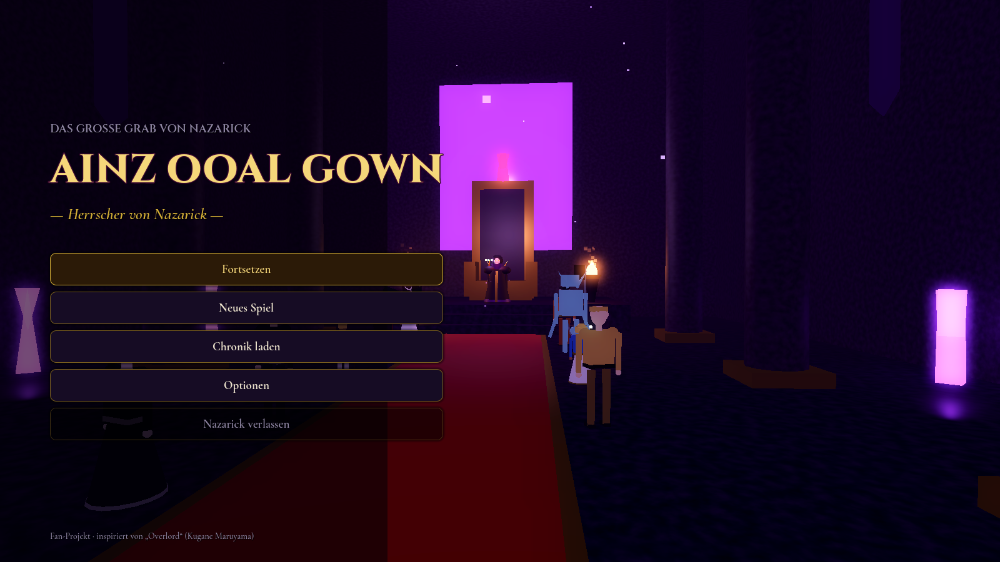
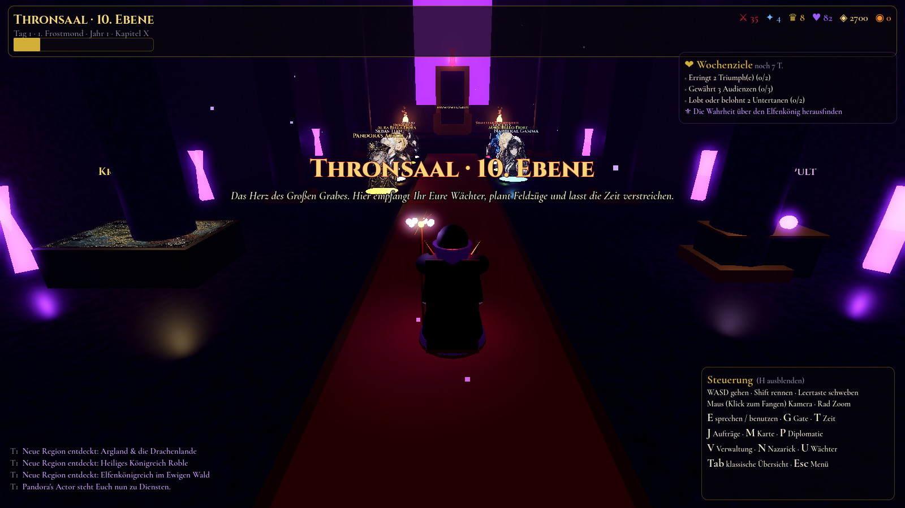
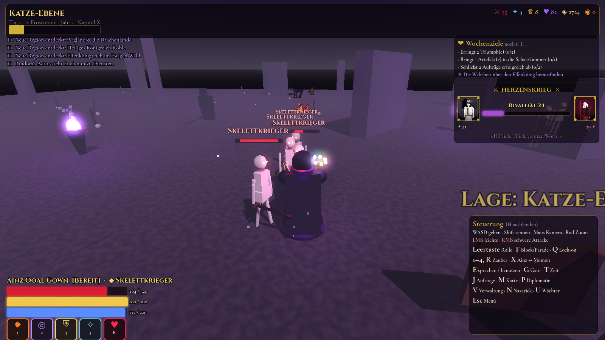
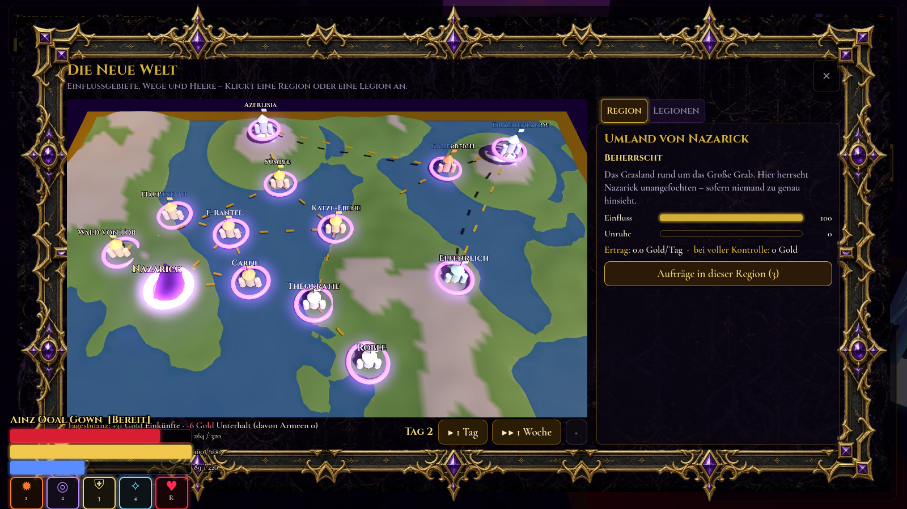
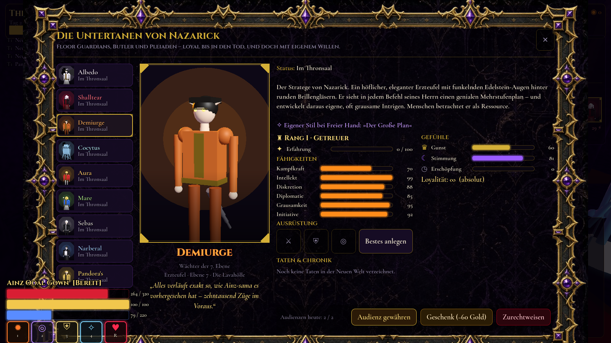
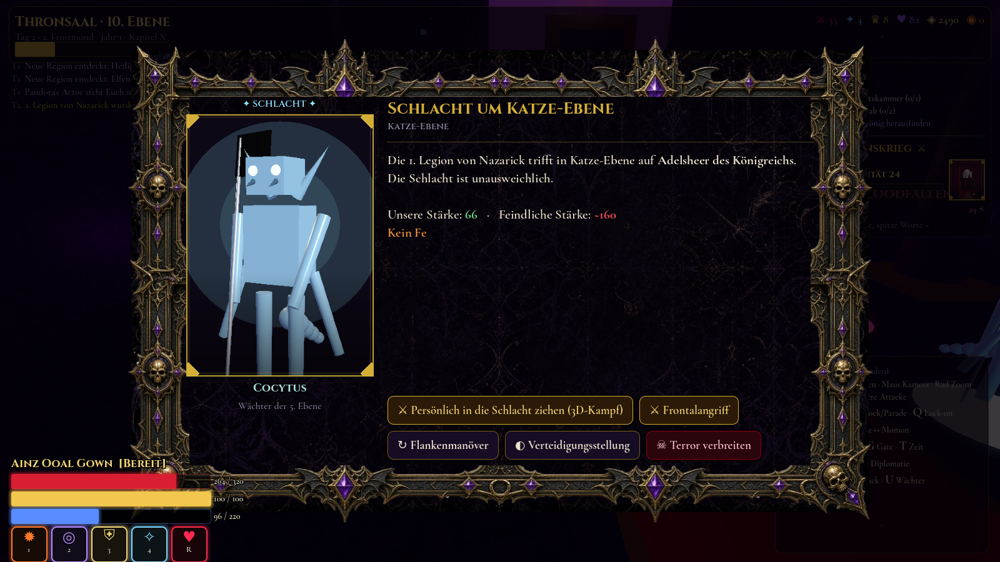
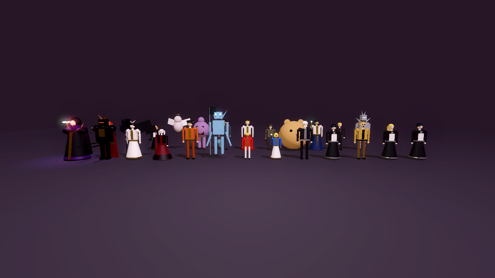

# Overlord – Herrscher von Nazarick

Ein **3D-Third-Person-Action-RPG mit Herrscher- und Strategie-Ebene** in **Godot 4** (GDScript), inspiriert von *Overlord* – spielerisch angelehnt an *The Witcher 3* (Kampf), *Mass Effect/Dragon Age* (Gefährten, Entscheidungen) und *Anno/Civilization* (Verwaltung, Einfluss, Feldzüge).
Du bist **Momonga / Ainz Ooal Gown**: Du gehst selbst durch das Große Grab und die Neue Welt, gewährst deinen Wächtern Audienzen, erteilst Befehle am Kriegstisch, führst Schlachten persönlich – und deine Wächter führen alles auf **ihre eigene Weise** aus.



| Thronsaal (begehbar) | Kampf auf der Katze-Ebene |
|---|---|
|  |  |
| **Die Weltkarte als 3D-Kriegstisch** | **Audienz – Portraits sind 3D-Renders** |
|  |  |
| **Schlacht persönlich anführen** | **Die Figuren von Nazarick** |
|  |  |

Alles ist 3D: Orte, Figuren, Weltkarte, Titelbildschirm. Die Figuren und Gebäude sind prozedural gebaut und werden automatisch durch echte `.glb`-Modelle ersetzt, sobald sie vorliegen (siehe *3D-Modelle*). Menüs (Aufträge, Verwaltung, Diplomatie …) erscheinen als Fenster über der 3D-Welt.

---

## Installieren (Windows)

1. `OverlordNazarick-Setup-2.4.0.exe` ausführen (liegt nach dem Build unter `build/`).
2. Windows SmartScreen meldet evtl. „Unbekannter Herausgeber“ (die Datei ist nicht signiert) → **Weitere Informationen → Trotzdem ausführen**.
3. Installation durchklicken – danach gibt es Verknüpfungen auf dem Desktop und im Startmenü. Deinstallieren über „Apps & Features“.

Selbst bauen (Linux/macOS/WSL mit Godot 4.3, Windows-Exportvorlage und NSIS):

```bash
GODOT=/pfad/zu/godot ./tools/build_windows.sh
# → build/windows/OverlordNazarick.exe        (portable Einzeldatei, kein Installer nötig)
# → build/OverlordNazarick-Setup-2.4.0.exe    (Installer mit Startmenü/Desktop-Verknüpfung)
```

---

## Starten aus dem Quellcode

1. **Godot 4.3** oder neuer installieren (Standard-Version, kein .NET nötig): <https://godotengine.org/download>
2. Godot öffnen → **Importieren** → `project.godot` in diesem Ordner wählen → **Importieren & Bearbeiten**.
3. **F5** (oder ▶ oben rechts) – das Spiel startet mit dem Titelbildschirm.

Ohne Editor, direkt aus der Kommandozeile:

```bash
godot --path /pfad/zu/Overlord
```

Renderer: *Compatibility* (OpenGL 3.3) – läuft also auch auf älteren Grafikkarten und Laptops. Fenstergröße 1600×900, frei skalierbar.

---

## Third-Person: Nazarick begehen

Du betrittst Nazarick und die Neue Welt **selbst** – als Ainz Ooal Gown in der dritten Person. Neue Spieler werden von Albedo, Demiurge, Cocytus und Shalltear durch eine kurze Einführung geführt (erneut abrufbar im Menü).

| Steuerung | |
|---|---|
| Gehen / Rennen | `WASD` / `Shift` |
| Kamera / Zoom | Maus (Klick fängt den Zeiger) / Mausrad |
| Sprechen, benutzen | `E` |
| Gate (Reisen), Zeit, Aufträge, Karte | `G`, `T`, `J`, `M` |
| Diplomatie, Verwaltung, Nazarick, Wächter | `P`, `V`, `N`, `U` |
| Chronik, Speichern, Menü | `C`, `F5`, `Esc` |

- **20 begehbare Orte**: Thronsaal, Grabkammern, Eisgletscher, Dschungel & Amphitheater, Lavahölle, Königliche Gemächer, Bibliothek von Ashurbanipal, Schatzkammer – sowie Carne, E-Rantel, die Königshauptstadt, Arwintar, das Heilige Königreich, die Theokratie, der Wald von Tob, der Elfenwald, die Sümpfe, die Katze-Ebene, das Azerlisia-Gebirge und die Drachenlande. Reisen per **Gate**; Regionen der Welt müssen erst erkundet sein.
- **Die Wächter sind dort, wo sie wirklich sind**: im Thronsaal, auf ihrer Ebene, am Einsatzort ihres Auftrags oder als Feldherr bei ihrer Legion – als 3D-Figuren (Albedo mit Hörnern und schwarzen Flügeln, Shalltear im Ballkleid mit Lanze, Demiurge mit Brille und Schwanz, der vierarmige Cocytus …). Stimmung zeigt sich in Haltung und Licht. Ansprechen öffnet die Audienz.
- **Weltkarte als 3D-Kriegstisch**: Reliefgelände, Burgen der Fraktionen, Nazarick als Pyramide, Wege, eigene Legionen und feindliche Heere als Spielfiguren, die über das Gelände ziehen. Rechte Maustaste dreht, Mausrad zoomt.
- **Schlachten persönlich anführen**: Trifft eine Legion auf den Feind, kann Ainz per Gate aufs Schlachtfeld und die feindliche Armee in 3D besiegen – oder dem Feldherrn mit einer Taktik das Kommando lassen.
- **Thron** (Zeit), **Kriegsrat** (Aufträge, Karte, Diplomatie), **Albedos Pult** (Verwaltung, Ausbau, Schatzkammer, Wochenziele) und **Lagetafeln** in jeder Region verbinden die Welt mit allen Management-Systemen.
- Die **Zeit läuft in Echtzeit** (ein Tag je 45 Sekunden, am Thron anhaltbar); Berichte, Ereignisse und Schlachten erscheinen als Depeschen.
- Story-Figuren begegnen dir je nach Kapitel: Gazef, Nigun, Clementine, Hamsuke, Jircniv, Neia, die Platinrüstung …

Alle Umgebungen, Figuren und Himmel werden prozedural erzeugt; echte `.glb`-Modelle ersetzen sie automatisch.

## Kampfsystem (Third-Person, im Stil von The Witcher 3)

| Aktion | Taste |
|---|---|
| Leichte Attacke (Kombo) / Schwere Attacke | linke / rechte Maustaste |
| Ausweichrolle (mit i-Frames) | `Leertaste` |
| Blocken – früh gedrückt = **Parieren** | `F` halten |
| Ziel fixieren (Lock-on) | `Q` |
| Zauber bzw. Techniken | `1` `2` `3` `4` `5` `R` |
| Superrang-Magie (nur Ainz) | `Y` (QWERTZ; auf US-Tastaturen `Z`) |
| Kampfstil wechseln: Ainz ↔ Momon | `X` |
| Zauberbuch (Seelen, Zauber, Ringe) | `B` |

- **Zustandsautomat** für Spieler und Gegner (`scripts/combat/fighter.gd`): Bereit · Bewegung · Angriff (*Wind-up → aktiv → Recovery*) · Ausweichen · Block · Zauber · Taumeln · Gelähmt · Tot.
- **Hitboxes/Hurtboxes** (`hitbox.gd`, `hurtbox.gd`): echte Area3D-Trefferzonen auf getrennten Physik-Ebenen; jeder Angriff trifft ein Ziel höchstens einmal, Bogen-/Reichweitenprüfung inklusive.
- **Ausdauer** (schwere Attacken, Rolle, Blocken, Momons Techniken) und **Mana** (Ainz' Zauber) regenerieren sich; **Haltung (Poise)** bricht bei wuchtigen Treffern → Taumeln.
- **Schaden**: Rüstung mindert physischen Schaden, Widerstände je Schadensart (physisch, Feuer, negativ, heilig); wer nach einem verfehlten Angriff in der Recovery steht, nimmt mehr Schaden.
- **Statuseffekte**: Brennen (Schaden über Zeit), Unterkühlt (verlangsamt), Gelähmt, Schutzbarriere.
- **Ainz** – magiefokussiert: Stabhiebe plus *Feuerkugel* (Projektil mit Flammenschweif, Explosion, entzündet), *Kettendrachenblitz* (springt auf bis zu fünf Ziele), *Druckwelle* (stößt zurück, bricht jede Deckung – wie Aard), *Größere Magische Schutzbarriere* (Wabenschild, absorbiert einen Treffer – wie Quen), *Lähmung* (Bannkreise – wie Axii), der **Herzgriff** (ein geisterhaftes Herz schlägt immer schneller, bis Ainz die Hand schließt) und die Superrang-Magie **Fallen Down**: vier Sekunden Beschwörung mit Kranz aus Magiekreisen, dann fällt eine Säule aus Licht vom Himmel.
- **Momon** – zwei Großschwerter: 3-Schlag-Kombo, Großschwert-Spaltung, *Sprungangriff* (Bogen mit Nachbildern, Krater beim Aufschlag), *Schwerterwirbel* und *Schwertwurf* (Ausdauer); mehr Leben und Rüstung, kaum Mana.
- **Treffergefühl** (`combat_fx.gd`): Trefferstopp (Angreifer und Opfer frieren kurz ein), federndes Zurückzucken am Skelett der Figuren, Funken an Rüstung, Blut und Blutnebel an Fleisch, Knochensplitter an Untoten, Steinbrocken an Golems, Lichtfunken an Engeln – mit Bodenkollision und Blutflecken am Boden. Hiebspuren genau auf der Trefferzone, Kamera-Erschütterung, Blickwinkel-Stoß, kurze Zeitlupe bei Paraden und großen Siegen, Schadenszahlen mit **Kritisch**, **Rückentreffer**, **Konter** und **Wehrlos**. Erschütterung und Trefferstopp lassen sich in den Einstellungen abschwächen bzw. abschalten.
- **Kampfgeräusche** (`tools/audio/combat_sfx.py`, prozedural): Schwünge, Treffer je Stoff, Block, Parade, Explosionen, Blitze, Eis, Schatten, Licht, Herzschlag, Superrang – als Raumklang mit Hall je Ort.
- **Gegner-KI mit Gruppenregie** (`enemy_3d.gd`, `combat_director.gd`): höchstens zwei Nahkämpfer und zwei Schützen greifen gleichzeitig an, die anderen umkreisen Ainz auf eigenen Plätzen (Wölfe und Quagoa im Rücken). Verhaltensarten: Fußvolk, Duellanten (blocken und kontern), Hünen (unaufhaltsame schwere Schläge), Rudeltiere, Plänkler (zuschlagen, ausweichen), Bogenschützen und Zauberer (halten Abstand, schießen mit Vorhalt, Flächenzauber mit Bodenwarnung, Beschwörungen), Bosse mit Phasen bei halbem Leben. Gegner rufen sich gegenseitig zu Hilfe und weichen Feuerkugeln aus; Todesritter überleben den ersten tödlichen Treffer.
- **Lesbare Angriffe**: Beim Ausholen pulsieren Gegner **orange (blockbar)** oder **rot (nur ausweichen!)**, schwere Schläge und Flächenzauber zeigen eine sich füllende Bodenwarnung, kurz vor dem Treffer blitzt es (jetzt blocken = Parade). Angriffe außerhalb des Blickfelds melden Pfeile am Bildschirmrand, rote Bögen zeigen, woher Ainz getroffen wurde; Bosse bekommen einen großen Lebens- und Haltungsbalken.
- **Gegner** (`data/combat.json`): Skelettkrieger und -schützen, Ältester Leichnam, Todesritter, Ritter, Schützen und Magier der Schrift (beschwören Flammenerzengel), Engel der Herrschaft, Wölfe, Echsenkrieger und -schamanen, Quagoa, Elfenkrieger und -schützinnen, Söldner – dazu Bosse wie Zaryusu, Brain, Gagaran, Succulent (Spiegelbilder) und der Elfenkönig.
- Begegnungen je Ort in `data/locations.json` (`encounters`). Besiegte Gegner bringen Gold, Eliten zusätzlich Beute. Fällt Ainz, zieht er sich nach Nazarick zurück (Stimmung −4).
- Werte anpassen: `data/combat.json` (Stile, Angriffe mit `windup/active/recovery/damage/range/arc/stagger/lunge/unblockable`, Zauber, Gegner).

---

## Fortschritt im Kampf: Seelen, Zauberbuch und Ringe

Jeder besiegte Gegner gibt **Seelen** frei – violette Lichter, die aufsteigen und in einem Bogen zu Ainz fliegen (Fußvolk wenige, Eliten und Bosse viele, Beschworene kaum). Der Zähler steht neben Ainz' Namen im HUD.

- **Zauberbuch** [`B`]: Seelen in Macht verwandeln. Jeder Zauber und jede Technik steigt von **Rang I bis III** (mehr Schaden, kürzere Abklingzeit, geringere Kosten) – Rang III mit Sonderwirkung: *Feuerkugel* dreifach maximiert (drei Kugeln im Fächer), *Kettendrachenblitz* springt auf acht Ziele, *Druckwelle* betäubt, *Schutzbarriere* fängt zwei Treffer ab, *Lähmung* bannt drei Feinde, *Herzgriff* schneller, *Fallen Down* größer; Momons *Schwerterwirbel* doppelt, *Schwertwurf* mit beiden Klingen.
- **Neue Magie** zum Erlernen: **Negative Burst** (Ausbruch negativer Energie rings um Ainz), **Erschaffe Untoten: Todesritter** (erhebt sich aus dem Boden und kämpft an Ainz' Seite, auf Rang III zwei), **Schwarzes Loch** (saugt Feinde an und verschlingt sie, ab Kapitel 3), **Realitätsschnitt** (zerschneidet den Raum entlang einer Linie, unblockbar, ab Kapitel 5); für Momon **Unbeugsame Haltung** und **Erdspaltung**.
- **Zauberleiste frei belegen**: im Zauberbuch jeden bekannten Zauber auf `1`–`5` oder `R` legen; die Rang-Rauten erscheinen über den Tasten.
- **Ringe des Overlords**: drei Plätze, 18 Ringe in fünf Seltenheiten (Feuer-, Sturm-, Todesschaden, Abklingzeiten, Lebensraub, Leben, Mana, Rüstung, Seelen …) – darunter einzigartige Ringe aus jedem Kapitel-Moment (*Ring der Urflamme*, *Siegel von Carne*, *Ring des Herrschaftsengels*, *Ring der Kampfkünste*, *Blutroter Ring*, *Platinsiegel*). Überzählige Ringe werden zu Seelen eingeschmolzen.
- **Beute zum Aufheben**: Eliten und Bosse lassen leuchtende Funde mit Lichtsäule in der Farbe ihrer Seltenheit fallen – Ringe für Ainz oder Artefakte für die Schatzkammer. Ainz hebt sie im Vorbeigehen auf.
- Acht neue Errungenschaften (Seelensammler, Meister aller Künste, Der Höchste der Magier, Die Hand des Overlords …). Erinnerungen im Questbuch bringen keinen Lohn.
- Werte: `data/grimoire.json` (Seelen, Rangkosten und -wirkung, Sonderwirkungen, Ringe), neue Zauber in `data/combat.json`.

---

## Story-Einsätze: die großen Momente selbst erleben

Zwölf Schlüsselmomente der Geschichte – aus allen Kapiteln von der Ankunft bis zum Platin-Drachenlord – lassen sich statt per Depesche **selbst in 3D spielen** – mit Filmszenen (Letterbox, Kamerafahrten, Untertitel mit Porträt, Ainz' Gedanken), Verbündeten an Ainz' Seite und Bossen mit Zwischenszenen. Erscheint die Depesche, bietet sie *„⚔ Selbst erleben“* an; die im Einsatz getroffene Entscheidung wird wie eine Antwort in der Depesche gewertet.

| Moment | Ort | Was passiert |
|---|---|---|
| **Der Treueschwur der Wächter** | Amphitheater, 6. Ebene | Magietest mit Aura und Mare gegen einen Urfeuer-Elementar; die Wächter treffen ein (Shalltear per Gate, Cocytus im Frosthauch), knien nieder – und beantworten die Frage, wer Ainz für sie ist. |
| **Rauch über Carne** | Dorf Carne (brennend) | Enri und Nemu auf der Flucht, das Gate, Herzgriff und Drachenblitz, ein Todesritter erhebt sich, Albedo kommt nach; Kampf um den Dorfplatz gegen die Ritter und ihren feigen Hauptmann Belius. |
| **Die Sonnenlicht-Schrift** | Carne, Abenddämmerung | Gazef wird ausgetauscht, Nigun beschwört Engel, die Prinzipalität und schließlich den Engel der Herrschaft – Heiliges Urteil, „Das also ist Schmerz“, Schwarzes Loch. Am Ende: Negative Burst oder Gefangennahme. |
| **Die Nacht der Untoten** | Friedhof von E-Rantel | Als Momon mit Nabe durch die Untotenflut, ein Ältester Leichnam, Khajit und Clementine am Mausoleum; Kettendrachenblitz, die Enthüllung – und Nfireas Schicksal. |
| **Overlord gegen Wahren Vampir** | Wald von Tob, Mitternacht | Das Duell gegen die beherrschte Shalltear mit Einherjar-Abbild und Blutrausch; beendet mit Fallen Down (kostet 150 Gold) oder List. |
| **Frost über dem Sumpf** | Sümpfe der Echsenmenschen | Ainz lässt den ganzen See in einer Welle zu Eis erstarren; **als Cocytus** kämpft Ihr gegen die Krieger der Stämme, Zenberu und Zaryusu mit Frost Pain – danach bittet Crusch um sein Leben: Wiederbelebung oder nicht. |
| **Gehenna** | Königshauptstadt bei Nacht | Eine haushohe Gehenna-Flamme quer durch die Stadt, brennende Häuser, Dämonen aus dem Feuer; **als Momon** mit Nabe gegen den maskierten Jaldabaoth – ein aufgeführter Kampf, den die Stadt nie vergisst. Danach legt Demiurge seine Liste vor. |
| **Die Schlacht auf der Katze-Ebene** | Katze-Ebene | Der Nebel lichtet sich vor einem Heer aus Tausenden Soldaten. *Iä Shub-Niggurath*: Superrang-Kreise, die Sanduhr, ein schwarzer Wind, unter dem die Reihen fallen, fünf Dunkle Junge steigen aus dem Boden – oder Todesreiter brechen nur die Adelsbanner. Zum Schluss Gazef Stronoffs Duell. |
| **Die Hallen von Feo Jera** | Azerlisia-Gebirge | Ainz, Aura und Shalltear retten den Runenschmied Gondo vor den Quagoa und ihrem Herrn Pe Riyuro; danach die Frage, was aus der Runenkunst wird. |
| **Das Mädchen mit den bösen Augen** | Heiliges Königreich, vor der Großen Mauer | Neia verteidigt zwei Kinder gegen Bafolk und Höllenhunde, die Paladine zögern – der Zauberkönig erscheint. Ihre Frage: Warum rettet ein Untoter die Schwachen? |
| **Der Elfenkönig** | Ewiger Wald, Thron aus lebendem Holz | Decem Hougan beleidigt Aura und Mare: Ainz kämpft selbst, **Aura kämpft mit Mare an ihrer Seite** – oder der König wird gelähmt der Theokratie übergeben. |
| **Das Gleichgewicht der Welt** | Katze-Ebene, Nebel bei Nacht | Die Platinrüstung stellt die Frage nach Ainz' Absicht: Frieden – oder ein Kampf gegen schwebende Klingen an der Seite von Albedo und Cocytus. |

- **Technik** (`scripts/story/`): `story_mission.gd` (Ablauf: Szenen, Wellen, Bosse mit Einführung, Schwellen-Szenen und Aufgeben, Wegpunkte, Verbündete), `cutscene.gd` (Kamera relativ zu Figuren mit Sichtprüfung, Figuren stellen/gehen/knien/stürzen/aus dem Boden steigen, Effekte, Entscheidungen), `story_fx.gd` (Gate, Großbrand, Schutzkuppel, Schwarzes Loch, gefrierendes Wasser, Gehenna-Flamme, Superrang-Kreise, Sanduhr, schwarzer Wind, Tageszeit-Stimmungen, Kulissen wie der Elfenthron), `army_crowd.gd` (Heer aus Tausenden Soldaten in einem MultiMesh, fällt im Shader), `dark_young.gd` (Dunkles Junges, ganz prozedural), `scripts/ui/cinematic_ui.gd` (Letterbox, Untertitel, Entscheidungen, `Esc` überspringt).
- **Inhalte**: `data/story_missions.json` – Schritte und Szenen als Daten, Gegner und Verbündete in `data/combat.json`, neue Figuren in `data/figures.json`.
- **Verbündete** kämpfen eigenständig, folgen Ainz und kündigen ihre Angriffe in Blau an; Bosse können **aufgeben** (knien nieder), Untote ihres Gefolges zerfallen, Lebende ergeben sich.
- **Kapitel-Momente** im Questbuch [`J`]: erlebte (oder ohne Euch entschiedene) Momente lassen sich als **Erinnerung** erneut spielen – ohne Lohn und ohne Folgen für das Reich.
- Scheitert Ainz in einem Einsatz, wartet die Depesche weiter: erneut versuchen oder anders entscheiden.

---

## 3D-Modelle (.glb) einbinden

Das Spiel nutzt **echte 3D-Modelle**, sobald sie vorhanden sind – sonst automatisch die prozeduralen Ersatzfiguren und -gebäude. Auch die Portraits in Dialogen und Menüs werden aus dem jeweiligen Modell gerendert.

**Ablage** (Dateiname = ID, `.glb` empfohlen, auch `.gltf`/`.tscn`):

| Ordner | Inhalt |
|---|---|
| `assets/models/characters/<id>.glb` | Figuren: Ainz, Momon, Wächter, NPCs, Gegner |
| `assets/models/props/<id>.glb` | Requisiten/Gebäude, ersetzen die Grundformen überall im Spiel |
| `assets/models/locations/<ort>.glb` | ein ganzer Ort – ersetzt das prozedurale Rezept komplett |

Zusätzlich lädt das Spiel Modelle **zur Laufzeit ohne Neu-Export** aus `<Spielordner>/models/<kind>/` und `user://models/<kind>/` (z. B. `%APPDATA%\Godot\app_userdata\Overlord – Herrscher von Nazarick\models\characters\albedo.glb`).

**Anforderungen**
- Maßstab 1 Einheit = 1 Meter, Figuren ca. 1,8–2,3 m, Ursprung zwischen den Füßen, Blick nach **+Z** (sonst `rot_y` in `data/models.json`).
- Figuren mit Skelett und Animationen im selben `.glb`. Erkannt werden (Groß-/Kleinschreibung egal, Teilwort genügt – erweiterbar in `data/models.json → animation_aliases`):
  `idle`, `walk`, `run`, `attack_light` (*attack, slash, attack1 …*), `attack_heavy` (*heavy, slam, attack2 …*), `dodge` (*roll*), `block`, `hit`, `stagger`, `death`, `cast`.
  Angriffs-Animationen werden automatisch auf die Dauer des jeweiligen Angriffs gestreckt.
- Pro Modell optional in `data/models.json`: `{"characters": {"albedo": {"scale": 1.0, "rot_y": 180, "y": 0, "anims": {"attack_light": "Albedo_Slash"}}}}`.
- Requisiten erhalten automatisch eine Kollision aus ihren Meshes.
- Orts-Modelle können Ankerpunkte als benannte Knoten (Empty/Marker) enthalten: `Spawn`, `Gate`, `Throne`, `Table`, `Desk`, `Board`, `Keeper`, `Slot1` … `SlotN`.
- Quellen: selbst modelliert (Blender), lizenzfreie Pakete oder KI-Generatoren mit passender Lizenz; Animationen z. B. über Mixamo. Keine Modelle aus offiziellen Spielen/Anime ohne Rechte.

**Noch fehlende Modelle** (alle derzeit Ersatzfiguren):

- Figuren: `ainz`, `ainz_momon`, `albedo`, `shalltear`, `demiurge`, `cocytus`, `aura`, `mare`, `sebas`, `narberal`, `pandora`, `solution`, `yuri`, `lupusregina`, `entoma`, `cz`, `victim`, `neuronist`, `gazef`, `jircniv`, `neia`, `hamsuke`, `nigun`, `clementine`, `platinum_dragon`, `death_knight`, `skeleton`, `death_knight`, `soldier`, `wolf`, `angel`, `golem`
- Requisiten: `house`, `tower`, `tree`, `tree_conifer`, `rock`, `brazier`, `pillar`, `crystal`, `banner`, `throne`, `war_table`, `desk`, `gate_portal`, `coffin`, `bookshelf`, `tent`, `stilt_hut`, `gold_pile`, `chest`, `palace`, `cathedral`, `city_wall_segment`, `ice_spike`, `statue`
- Ganze Orte (optional): `throne`, `tombs`, `glacier`, `jungle`, `lava`, `royal`, `library`, `treasury`, `carne`, `e_rantel`, `re_capital`, `baharuth`, `roble`, `theokratie`, `tob_wald`, `elfen`, `sumpf`, `katze`, `azerlisia`, `drachen`

Der Test `tools/combat_test.tscn` erzeugt zur Laufzeit ein Test-`.glb` mit Animationen, lädt es über `ModelLib`, prüft die Animationszuordnung und das Platzieren eines Requisits mit Kollision.

---

## Spielanleitung

| Aktion | In der Welt | Taste |
|---|---|---|
| Aufträge erteilen | Kriegsrat im Thronsaal / Lagetafel jeder Region | `J` |
| Weltkarte (3D-Kriegstisch), Legionen | Kriegsrat | `M` |
| Diplomatie | Kriegsrat | `P` |
| Finanzen & Erlasse | Albedos Pult | `V` |
| Wächter ansehen, Audienz gewähren, ausrüsten | Wächter ansprechen (`E`) | `U` |
| Nazarick: Ausbau, Schatzkammer, Wochenziele, Errungenschaften | Albedos Pult | `N` |
| Zeit vergehen lassen (1 Tag / Woche / Monat, Zeitfluss anhalten) | Thron | `T` |
| Reisen | Gate | `G` |
| Depesche öffnen | – | `Enter` |
| Chronik · Speichern · Menü · Vollbild | – | `C` · `F5` · `Esc` · `F11` |

**Der Kreislauf**

1. **Auftrag wählen** – Hauptaufträge (★) treiben die Story voran, Nebenaufträge (◆) bringen Ressourcen, Vorschläge (✧) stammen von deinen Untertanen selbst.
2. **Vollstrecker wählen** – jede Kachel zeigt die Erfolgsaussicht. Manche Aufträge kann nur ein bestimmter Charakter erledigen.
3. **Befehlsart wählen**: *Freie Hand*, *Im Verborgenen*, *Gnadenlos*, *Diplomatisch*, *Mit höchster Eile*.
   Die Tafel warnt dich, wenn ein Charakter dazu neigt, einen Befehl **eigenmächtig auszulegen** (Shalltear und „diskret“ … nun ja), und zeigt seinen **eigenen Stil** bei *Freier Hand* (Demiurge: „Der Große Plan“).
4. **Zeit vergehen lassen.** Sie stoppt automatisch, sobald eine **Depesche** eintrifft: Bericht, Ereignis, Eigeninitiative oder Vorschlag.
5. **Reagieren** – loben, belohnen, tadeln oder schweigen. Jede Reaktion hat Folgen – besonders bei Albedo und Shalltear.

**Ressourcen**: Macht · Wissen · Ruf · Stimmung · Gold · **Aufmerksamkeit** (wie sehr die Welt auf Nazarick aufmerksam wird – hohe Werte locken gefährliche Mächte an) · **Effizienz der Guardians** (aus Stimmung, Gunst und Erschöpfung).

**Herzenskrieg**: Lobst du Albedo, wird Shalltear eifersüchtig – und umgekehrt. Steigt die Rivalität, kommt es zu Streit im Thronsaal, nächtlichen Besuchen, eigenmächtigen Intrigen und im Extremfall zu einem Duell im Amphitheater. Vernachlässigte oder eifersüchtige Untertanen ergreifen häufiger eigenmächtig die Initiative.

**Die Strategie-Ebene**

- **Weltkarte [M]** – 13 Regionen mit Einfluss, Unruhe und täglichen Einkünften. Regionen müssen erst erkundet werden; Einfluss wächst durch Aufträge (mit abnehmendem Ertrag), Grausamkeit erzeugt Unruhe und Aufstände.
- **Reichsverwaltung [V]** – Finanzübersicht (Einkünfte je Region, Unterhalt für Grab, Einsätze, Erlasse und Legionen) und **Erlasse**: zehn Regierungsentscheidungen mit laufenden Kosten und Wirkungen, begrenzte Plätze, und jeder Wächter hat eine Meinung dazu.
- **Diplomatie [P]** – 8 Fraktionen (Königreich Re-Estize, Baharuth-Kaiserreich, Slane-Theokratie, Argland-Rat, Zwerge, Heiliges Königreich Roble, Elfenkönigreich) mit Beziehung, Furcht und Verträgen: Geschenke, Handelsabkommen, Nichtangriffspakt, Machtdemonstration, Tribut, Vasallentum, Frieden, Krieg. Gesandtschaften führt ein Wächter aus – Albedo verhandelt brillant, Shalltear … eher nicht. Fraktionen reagieren auf Ruf und Aufmerksamkeit, schicken eigene Gesandte und erklären bei Hass den Krieg.
- **Legionen & Schlachten** – Skelette, Todesritter, Liche, Seelenfresser, Todesreiter … im Grab ausheben, einen Wächter zum Feldherrn ernennen (er fehlt dann für Aufträge), über das Wegenetz marschieren lassen (die Heere ziehen sichtbar über die Karte, mit eigener Zeitsteuerung), Regionen erobern oder feindliche Heere abfangen. Jede Schlacht kann Ainz **persönlich in 3D** schlagen – oder per Taktik dem Feldherrn überlassen.
- **Bedrohungen mit Frist** – Inquisition, Spione, Aufstände, Abenteurer-Expeditionen, der Platin-Drache: Wer nicht rechtzeitig reagiert, verliert Gebiete, Gold und Ansehen.
- **Lageberichte** – Mitten im Auftrag melden sich die Untertanen mit Komplikationen: Zeugen, starke Gegner, Doppelagenten … du entscheidest über Risiko, Dauer und Methode – oder lässt dem Wächter freie Hand.
- **Teams** – zwei Untertanen gemeinsam entsenden; Synergien (Aura + Mare, Albedo + Demiurge) und Konflikte (Albedo + Shalltear, Demiurge + Sebas).
- **Vier Schwierigkeitsgrade** – von *Gnädiger Herrscher* bis *Albtraum von Nazarick* (Startgold, Einkünfte, Unterhalt, Bedrohungen, Feindstärke).
- **Kapitelziele** verlangen neben Story-Entscheidungen auch Einfluss, Ressourcen und Zeit – das Reich muss wirklich wachsen.

**Das Große Grab wächst mit – „nur noch eine Woche …“**

- **Wächter-Ränge I–X** – jeder Auftrag, jede Schlacht und jede Audienz bringt Erfahrung. Ein Rangaufstieg (vom *Getreuen* bis zur *Legende von Nazarick*) erhöht alle Werte und stärkt die Legion, die der Wächter führt. Fanfare inklusive.
- **Artefakte & Schatzkammer** – 35 Artefakte in fünf Seltenheiten (*Gewöhnlich, Selten, Episch, Legendär, Weltklasse*): Triumphe, Schlachten, gebannte Bedrohungen, Errungenschaften und Albedos Truhe bringen Beute. Jeder Wächter hat Waffe, Rüstung und Kleinod; Lieblingsstücke (Spuhletit-Lanze für Shalltear, Frosthellebarde für Cocytus …) wirken stärker. Überzählige Funde lassen sich einschmelzen.
- **Ausbau der Ebenen** – 10 Bauwerke × 3 Stufen (Grabkammern, Gletscher, Amphitheater, Lavahölle, Königliche Gemächer, Bibliothek von Ashurbanipal, Schatzkammer, Golemschmiede …): billigere Legionen, stärkere Heere, mehr Erfahrung, Gold, Wissen, Audienzen, Beute. Immer nur ein Bauprojekt zugleich – jede Entscheidung zählt.
- **Albedos Wochenziele** – jede Woche drei neue Ziele mit Belohnung; wer alle erfüllt, öffnet **Albedos Truhe** (Gold + garantiert seltenes Artefakt). Aufeinanderfolgende Wochen bauen eine **Serie** auf, die die Truhe immer wertvoller macht.
- **45 Errungenschaften** in Bronze, Silber, Gold und Platin – mit Belohnungen bis hin zu einem Weltgegenstand.

**Story**: 11 Kapitel – *Die Ankunft · Das Dorf Carne · Der Dunkle Held · Blutiger Wahnsinn (der Shalltear-Zwischenfall) · Frost über dem Sumpf · Gehenna · Das Zauberkönigreich · Die Hallen von Feo Jera · Das Heilige Königreich · Der Wald der Elfen · Der Platin-Drachenlord* – mit einem **Epilog**, der sich aus deinen Entscheidungen zusammensetzt (Weltordnung, Ruf, Vasallen, Albedo & Shalltear, das Schicksal jedes Wächters). Danach geht die Herrschaft endlos weiter. Dazu 42 Aufträge (10 Haupt-, 15 Neben-, 17 Vorschlagsaufträge), 33 Ereignisse und 23 Eigeninitiativen, mit Verzweigungen (Carne retten oder ignorieren, Name „Ainz Ooal Gown“ annehmen oder Momonga bleiben, Shalltear selbst stellen oder Albedo schicken …).

Spielstände liegen in `user://saves/` (Windows: `%APPDATA%\Godot\app_userdata\Overlord – Herrscher von Nazarick\saves`).

---

## Projektstruktur

```
project.godot              Projekt (Autoloads, Theme, Compatibility-Renderer)
scenes/
  title_screen.tscn        Titelbildschirm (3D-Kamerafahrt durch den Thronsaal)
  world_3d.tscn            die begehbare Welt (Hauptszene des Spiels)
scripts/
  autoload/
    content.gd             lädt data/*.json
    game.gd                Spielzustand & Spiellogik (Aufträge, Zeit, Emotionen, Depeschen)
    world.gd, military.gd, diplomacy.gd   Regionen/Wirtschaft, Legionen/Schlachten, Fraktionen
    progress.gd            Ränge, Artefakte, Ausbau, Wochenziele, Errungenschaften
  world3d/
    world_3d.gd            Third-Person-Welt: Orte laden, HUD, Interaktion, Echtzeit, Depeschen, Kampf-HUD
    player_3d.gd           Ainz/Momon: Steuerung, Kamera, Kampf, Lock-on, Zauber
    model_lib.gd           findet/lädt .glb-Modelle (auch zur Laufzeit)
    character_rig.gd       Modell oder Ersatzfigur + Animationssteuerung
    proc_model.gd          prozedurale Ersatzfiguren mit Gelenken
    actor_3d.gd            Figuren als Portrait-Aufsteller, Interaktionsobjekte
    loot_drop.gd           Beute zum Aufheben (Lichtsäule in Seltenheitsfarbe)
    location_builder.gd    Rezepte der 20 Orte (Thronsaal, Gletscher, Stadt, Wald …)
    b3.gd                  3D-Baukasten (Materialien, Primitive mit Kollision, Licht, Partikel)
  combat/
    fighter.gd             Kämpfer-Basis: Zustandsautomat, Werte, Treffer, Status
    hitbox.gd, hurtbox.gd  Trefferzonen
    enemy_3d.gd            Gegner-KI: Verhaltensarten, Reaktionen, Fern-/Flächen-/Beschwörungsangriffe, Bossphasen
    combat_director.gd     Gruppenregie: Angriffsrechte, Kreisplätze, Alarm
    combat_fx.gd           Treffergefühl: Partikel, Trefferstopp, Zeitlupe, Kamera, Zahlen, Raumklang
    spell_fx.gd            Inszenierung der Zauber (Geschosse, Explosionen, Blitze, Herzgriff, Superrang)
    slash_fx.gd            Hiebspuren · ground_mark.gd Bodenwarnungen und Magiekreise · hit_react.gd Zurückzucken, Verbeugen, Knien
    projectile.gd          Geschosse (Lenkung, Pfeilflug)
    soul_orbs.gd           Seelen besiegter Gegner fliegen zu Ainz
    save_system.gd         JSON-Speichern/Laden (3 Slots)
  story/
    story_mission.gd       spielbare Story-Momente: Szenen, Wellen, Bosse (Einführung, Schwellen, Aufgeben), Verbündete
    cutscene.gd            Filmszenen: Kamera relativ zu Figuren, Figuren, Effekte, Entscheidungen
    story_fx.gd            Gate, Großbrand, Schutzkuppel, Schwarzes Loch, Tageszeit-Stimmungen
  scenes/                  Skripte der Szenen
  ui/
    palette.gd             zentrale Farbpalette
    nazarick_theme.gd      erzeugt das Theme (→ assets/ui/nazarick_theme.tres)
    ui_fx.gd               Tween-Animationen (Einblenden, Pop-in, Hover, Pulsieren, Schreibmaschine)
    portrait.gd            Portrait mit Rahmen; Bild-Asset oder prozeduraler Platzhalter
    guardian_card.gd       Statuskarte eines Wächters
    rivalry_meter.gd       „Herzenskrieg“-Anzeige Albedo ⚔ Shalltear
    throne_visual.gd       gezeichneter Thron mit dem Overlord
    background.gd          Shader-Hintergrund + Partikel
    overlay.gd             Basisklasse modaler Fenster
    dispatch_dialog.gd     Berichte / Ereignisse / Vorschläge
    mission_board.gd       Auftragstafel
    character_view.gd      Charakter-Details & Audienzen
    chronicle_view.gd, save_load_dialog.gd, portrait_button.gd, stat_bar.gd
data/
  characters.json          Charaktere: Werte, Stimme, Gefühle, Reaktionen, Vorschläge
  missions.json            Aufträge (Haupt, Neben, Vorschläge)
  events.json              Story-, Zufalls- und Rivalitätsereignisse + Eigeninitiativen
  story.json               Kapitel und Befehlsarten
  story_missions.json      spielbare Story-Einsätze (Schritte und Szenen als Daten)
  grimoire.json            Zauberbuch: Seelen, Zauberränge, Sonderwirkungen, Ringe
  regions.json, factions.json, systems.json   Strategie-Ebene
  progression.json         Ränge, Artefakte, Ebenen, Wochenziele, Errungenschaften
  locations.json           begehbare 3D-Orte, Story-Figuren, Begegnungen
  combat.json              Kampfstile, Angriffe, Zauber, Gegner
  models.json              Einstellungen & Animationsnamen für 3D-Modelle
assets/
  ui/                      Theme, Schriften (Cinzel, Cormorant Garamond, DejaVu – alle frei lizenziert)
  shaders/                 Hintergrund-Shader
  characters/              ← hier Portraits ablegen
  backgrounds/             ← hier Hintergründe ablegen
tools/                     Theme-Builder, Simulations- und UI-Tests
```

---

## Grafik

Das Spiel kommt ohne 2D-Artworks aus:

- **Figuren** werden prozedural aus `data/figures.json` gebaut (Hautfarbe, Frisur, Kleidung, Hörner, Flügel, Schwanz, Waffe, Sonderformen wie Cocytus, Pandora's Actor oder Hamsuke) und durch `assets/models/characters/<id>.glb` ersetzt, sobald vorhanden.
- **Portraits** in Dialogen, Berichten und Menüs sind **3D-Renders** dieser Figuren (`PortraitStudio`, einmal je Figur erzeugt; Stimmung färbt das Kantenlicht).
- **Orte, Himmel und Weltkarte** sind prozedural; Gebäude/Requisiten lassen sich durch `assets/models/props/*.glb` ersetzen, ganze Orte durch `assets/models/locations/*.glb`.
- **UI**: Schriften, Ornamentrahmen (`assets/ui/frames/`) und Icons (`assets/ui/icons/`, inkl. `item_<id>` und `frame_<seltenheit>` für Artefakte).

Eine Liste gewünschter Modelle und Icons steht in `docs/ASSET_WUNSCHLISTE.txt`.

**Grafikqualität** (Einstellungen → Grafik, `scripts/world3d/graphics_quality.gd`):

| Stufe | Was sie tut | Bildrate (RTX 3060 Ti, 3440×1440, FSR 2 77 %) |
|---|---|---|
| **Ultra** | alles in voller Qualität (kontaktgehärtete PCSS-Schatten, globale Beleuchtung in voller Auflösung) | Städte 47–56, Wälder 37–40 FPS |
| **Hoch** (Standard) | im Bild wie Ultra: PCSS mit halb so vielen Abtastungen, GI in halber Auflösung, SDFGI mit 8 Strahlen, Spiegelungen/SSIL/Nebel etwas gröber | Städte 54–62, Wälder 43–47 FPS |
| **Ausgewogen** | zusätzlich gefilterte PCF-Schatten, Schattenkarte 2048, keine Spiegelungen in der Natur, Gras und Bäume wechseln früher in ihre fernen Detailstufen | Städte 62–66, Wälder 54–61 FPS |

Keine Stufe reduziert die Dreiecke der Modelle. Messen: `LOC=bench BENCHLEVELS=2,1,0 godot res://tools/world3d_test.tscn` (mit `BENCHSHOT=1` Bilder bei angehaltener Zeit, `BENCHAB=1` Kosten je Effekt, `BENCHINFO=1` Dreiecksverteilung).

---

## Inhalte erweitern

Alle Inhalte sind JSON – neue Aufträge, Ereignisse oder Charaktere brauchen **keinen Code**.

**Neuer Auftrag** (`data/missions.json`):

```json
{
  "id": "s_beispiel", "title": "Der verfluchte Turm",
  "category": "Erkundung", "location": "Azerlisia-Gebirge",
  "description": "…", "days": 4, "difficulty": 55,
  "weights": {"intellekt": 2, "kampf": 1},
  "recommended": ["aura"],
  "rewards": {"info": 8, "gold": 50},
  "requires": {"chapter_min": 3},
  "on_success": {"set_flags": ["turm_erkundet"]},
  "outcomes": {"triumph": "…", "success": "…", "partial": "…", "failure": "…"},
  "char_outcomes": {"shalltear": {"success": "Text in Shalltears Stimme …"}}
}
```

Optionale Felder: `main`, `repeatable`, `required_char`, `forced_tier`, `followup_event`, `replace_report_with_event`, `failure`, `proposal` + `proposal_text` + `proposal_requires` (Vorschläge erscheinen nur, wenn ein Charakter sie unterbreitet – dazu die ID in `proposals` des Charakters eintragen).

**Neues Ereignis** (`data/events.json`): `type` ist `story` (einmalig, sobald `trigger` erfüllt), `random`/`rivalry` (gewichtet, mit `cooldown`/`once`) oder `chain` (nur über `queue_events`/`followup_event`). Jede Wahl (`choices`) hat `label`, `effects`, `reaction`, optional `variant` (`primary`, `danger`, `success`, `warning`) und `requires`.

**Bedingungen** (`requires`, `trigger`): `chapter`, `chapter_min/max`, `day_in_chapter_min`, `flags_all/none/any`, `rivalry_min/max`, `res_min/max`, `jealousy_min`, `favor_min/max`, `idle`, `unlocked`, `missions_done`.

**Effekte** (`effects`, `on_success`, `on_trigger`): `res`, `chars` (favor/mood/jealousy/fatigue), `rivalry`, `set_flags`, `clear_flags`, `unlock_missions`, `unlock_chars`, `status`, `lord_name`, `log`, `queue_events`.

**Platzhalter in Texten**: `{lord}` → „Momonga-sama“ bzw. „Ainz-sama“, `{lord_full}` → voller Name. Texte unterstützen BBCode (`[i]`, `[b]`, `[color=#ff2a4f]…[/color]`).

**Neuer Charakter**: Eintrag in `data/characters.json` nach dem Muster der vorhandenen (Werte, `voice`, `reactions`, `audience`, optional `emotion` + `rival` für eifersüchtige Charaktere, `deviations` für eigenmächtige Auslegungen, `style` für Freie Hand). Mit `"unlocked": false` startet er gesperrt und wird per Effekt `unlock_chars` freigeschaltet.

**Theme ändern**: Farben in `scripts/ui/palette.gd`, Stile in `scripts/ui/nazarick_theme.gd`, danach neu bauen:

```bash
godot --headless --path . --script res://tools/build_theme.gd
```

---

## Tests

```bash
# Spielt 6 Partien mit zufälligen Entscheidungen bis zum Ende, prüft Speichern/Laden
godot --headless --path . res://tools/sim_test.tscn
# 3D-Rauchtest: Titel, alle Orte, Kampf, Audienz, Kriegstisch, persönliche Schlacht; Screenshots nach tools/screenshots3d/
godot --path . res://tools/world3d_test.tscn     # LOC=<ort> | combat | title | gallery (alle Figuren + Portraits)
godot --headless --path . res://tools/combat_test.tscn   # Kampfsystem + .glb-Laden
# Story-Einsatz automatisch durchspielen (Szenen, Kämpfe, Entscheidung; Screenshots alle n Zeilen)
LOC=story STORY=sm_carne STORYCHOICE=0 STORYSHOTS=3 godot --path . res://tools/world3d_test.tscn   # STORYDISPATCH=1 | STORYREPLAY=1
```

---

*Nicht-kommerzielles Fan-Projekt. „Overlord“ © Kugane Maruyama / KADOKAWA. Schriften: Cinzel & Cormorant Garamond (SIL OFL), DejaVu Sans (freie Lizenz).*
