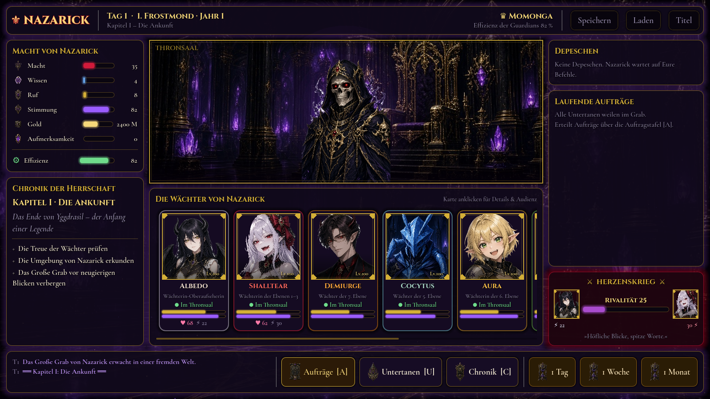
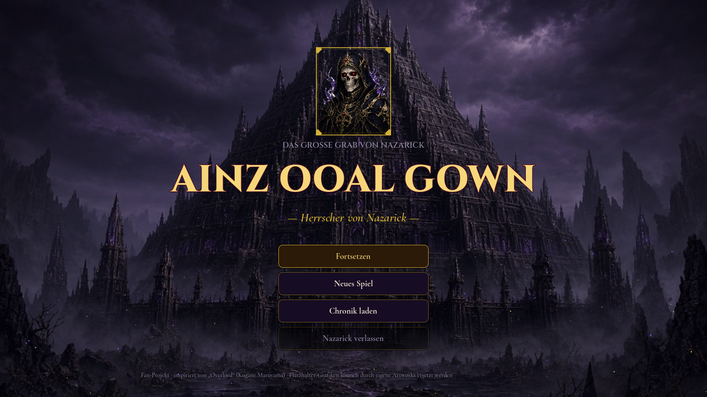
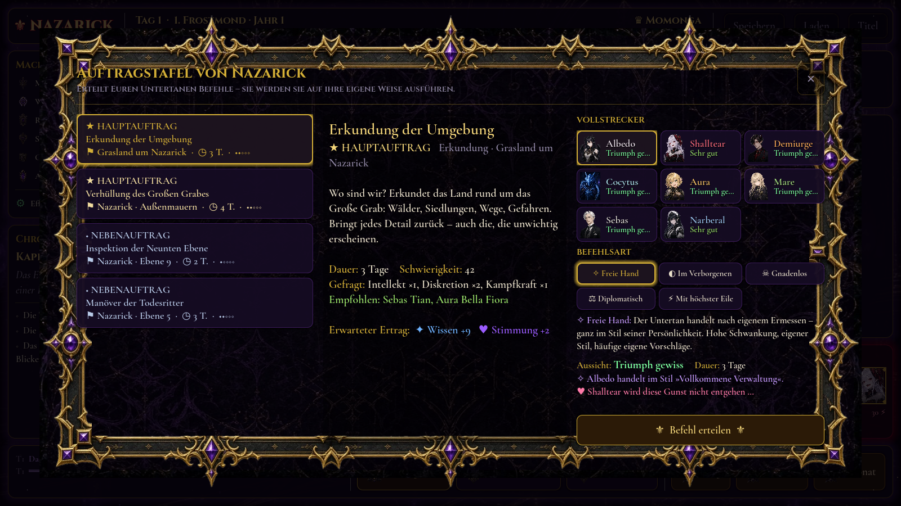
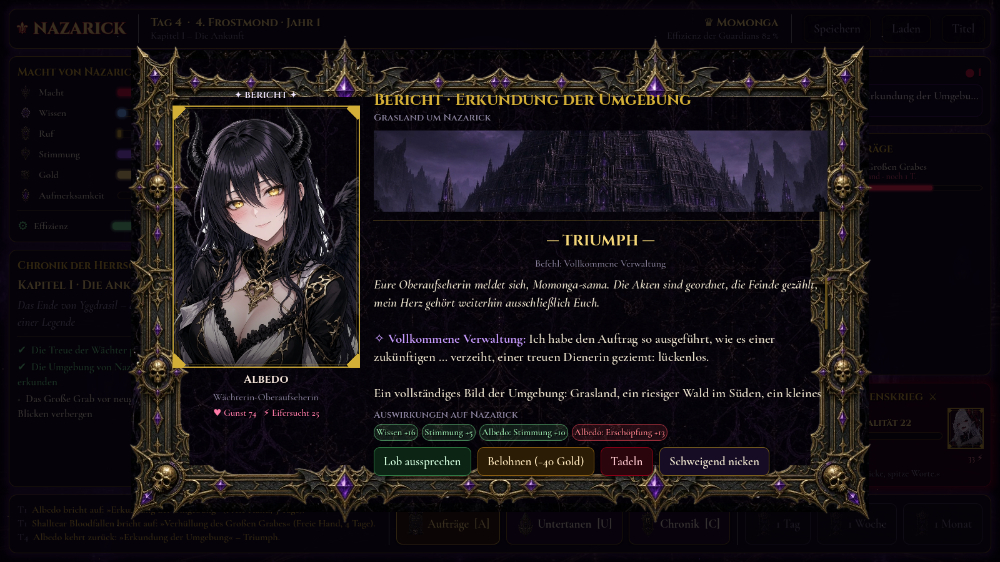
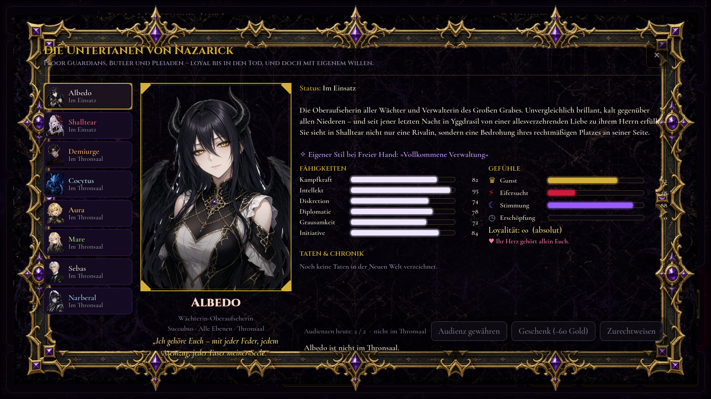

# Overlord – Herrscher von Nazarick

Ein 2D-Management- und Story-Spiel in **Godot 4** (GDScript), inspiriert von *Overlord* und optisch angelehnt an *Lord of Nazarick*.
Du bist **Momonga / Ainz Ooal Gown**. Vom Thron des Großen Grabes aus erteilst du deinen Wächtern Befehle – und sie führen sie auf **ihre eigene Weise** aus.



| Titel | Auftragstafel |
|---|---|
|  |  |
| **Bericht im Charakterstil** | **Charakteransicht & Audienz** |
|  |  |

Die Artworks (Portraits, Hintergründe, Rahmen, Icons) liegen in `assets/`. Fehlt ein Bild, zeichnet das Spiel automatisch einen stilisierten Platzhalter.

---

## Installieren (Windows)

1. `OverlordNazarick-Setup-1.0.0.exe` ausführen (liegt nach dem Build unter `build/`).
2. Windows SmartScreen meldet evtl. „Unbekannter Herausgeber“ (die Datei ist nicht signiert) → **Weitere Informationen → Trotzdem ausführen**.
3. Installation durchklicken – danach gibt es Verknüpfungen auf dem Desktop und im Startmenü. Deinstallieren über „Apps & Features“.

Selbst bauen (Linux/macOS/WSL mit Godot 4.3, Windows-Exportvorlage und NSIS):

```bash
GODOT=/pfad/zu/godot ./tools/build_windows.sh
# → build/windows/OverlordNazarick.exe        (portable Einzeldatei, kein Installer nötig)
# → build/OverlordNazarick-Setup-1.0.0.exe    (Installer mit Startmenü/Desktop-Verknüpfung)
```

---

## Starten aus dem Quellcode

1. **Godot 4.3** oder neuer installieren (Standard-Version, kein .NET nötig): <https://godotengine.org/download>
2. Godot öffnen → **Importieren** → `project.godot` in diesem Ordner wählen → **Importieren & Bearbeiten**.
3. **F5** (oder ▶ oben rechts) – das Spiel startet mit dem Titelbildschirm.

Ohne Editor, direkt aus der Kommandozeile:

```bash
godot --path /pfad/zu/Overlord
```

Renderer: *Compatibility* (OpenGL 3.3) – läuft also auch auf älteren Grafikkarten und Laptops. Fenstergröße 1600×900, frei skalierbar.

---

## Spielanleitung

| Aktion | Wo | Taste |
|---|---|---|
| Aufträge erteilen | Fußleiste → **Aufträge** | `A` |
| Untertanen ansehen, Audienz gewähren | Wächterkarte anklicken / **Untertanen** | `U` |
| Chronik (Event-Log) | **Chronik** | `C` |
| Nächste Depesche öffnen | Depeschen-Panel | `D` |
| Zeit vergehen lassen: 1 Tag / 1 Woche / 1 Monat | Fußleiste rechts | `1` / `2` / `3` |
| Speichern | Kopfleiste | `F5` |

**Der Kreislauf**

1. **Auftrag wählen** – Hauptaufträge (★) treiben die Story voran, Nebenaufträge (◆) bringen Ressourcen, Vorschläge (✧) stammen von deinen Untertanen selbst.
2. **Vollstrecker wählen** – jede Kachel zeigt die Erfolgsaussicht. Manche Aufträge kann nur ein bestimmter Charakter erledigen.
3. **Befehlsart wählen**: *Freie Hand*, *Im Verborgenen*, *Gnadenlos*, *Diplomatisch*, *Mit höchster Eile*.
   Die Tafel warnt dich, wenn ein Charakter dazu neigt, einen Befehl **eigenmächtig auszulegen** (Shalltear und „diskret“ … nun ja), und zeigt seinen **eigenen Stil** bei *Freier Hand* (Demiurge: „Der Große Plan“).
4. **Zeit vergehen lassen.** Sie stoppt automatisch, sobald eine **Depesche** eintrifft: Bericht, Ereignis, Eigeninitiative oder Vorschlag.
5. **Reagieren** – loben, belohnen, tadeln oder schweigen. Jede Reaktion hat Folgen – besonders bei Albedo und Shalltear.

**Ressourcen**: Macht · Wissen · Ruf · Stimmung · Gold · **Aufmerksamkeit** (wie sehr die Welt auf Nazarick aufmerksam wird – hohe Werte locken gefährliche Mächte an) · **Effizienz der Guardians** (aus Stimmung, Gunst und Erschöpfung).

**Herzenskrieg**: Lobst du Albedo, wird Shalltear eifersüchtig – und umgekehrt. Steigt die Rivalität, kommt es zu Streit im Thronsaal, nächtlichen Besuchen, eigenmächtigen Intrigen und im Extremfall zu einem Duell im Amphitheater. Vernachlässigte oder eifersüchtige Untertanen ergreifen häufiger eigenmächtig die Initiative.

**Story**: 7 Kapitel – *Die Ankunft · Das Dorf Carne · Der Dunkle Held · Blutiger Wahnsinn (der Shalltear-Zwischenfall) · Frost über dem Sumpf · Gehenna · Das Zauberkönigreich* – danach freies Spiel. Dazu 42 Aufträge (10 Haupt-, 15 Neben-, 17 Vorschlagsaufträge), 33 Ereignisse und 23 Eigeninitiativen, mit Verzweigungen (Carne retten oder ignorieren, Name „Ainz Ooal Gown“ annehmen oder Momonga bleiben, Shalltear selbst stellen oder Albedo schicken …).

Spielstände liegen in `user://saves/` (Windows: `%APPDATA%\Godot\app_userdata\Overlord – Herrscher von Nazarick\saves`).

---

## Projektstruktur

```
project.godot              Projekt (Autoloads, Theme, Compatibility-Renderer)
scenes/
  title_screen.tscn        Titelbildschirm
  throne_room.tscn         Thronsaal – zentrale Hub-Szene
scripts/
  autoload/
    content.gd             lädt data/*.json
    game.gd                Spielzustand & Spiellogik (Aufträge, Zeit, Emotionen, Depeschen)
    save_system.gd         JSON-Speichern/Laden (3 Slots)
  scenes/                  Skripte der Szenen
  ui/
    palette.gd             zentrale Farbpalette
    nazarick_theme.gd      erzeugt das Theme (→ assets/ui/nazarick_theme.tres)
    ui_fx.gd               Tween-Animationen (Einblenden, Pop-in, Hover, Pulsieren, Schreibmaschine)
    portrait.gd            Portrait mit Rahmen; Bild-Asset oder prozeduraler Platzhalter
    guardian_card.gd       Statuskarte eines Wächters
    rivalry_meter.gd       „Herzenskrieg“-Anzeige Albedo ⚔ Shalltear
    throne_visual.gd       gezeichneter Thron mit dem Overlord
    background.gd          Shader-Hintergrund + Partikel
    overlay.gd             Basisklasse modaler Fenster
    dispatch_dialog.gd     Berichte / Ereignisse / Vorschläge
    mission_board.gd       Auftragstafel
    character_view.gd      Charakter-Details & Audienzen
    chronicle_view.gd, save_load_dialog.gd, portrait_button.gd, stat_bar.gd
data/
  characters.json          Charaktere: Werte, Stimme, Gefühle, Reaktionen, Vorschläge
  missions.json            Aufträge (Haupt, Neben, Vorschläge)
  events.json              Story-, Zufalls- und Rivalitätsereignisse + Eigeninitiativen
  story.json               Kapitel und Befehlsarten
assets/
  ui/                      Theme, Schriften (Cinzel, Cormorant Garamond, DejaVu – alle frei lizenziert)
  shaders/                 Hintergrund-Shader
  characters/              ← hier Portraits ablegen
  backgrounds/             ← hier Hintergründe ablegen
tools/                     Theme-Builder, Simulations- und UI-Tests
```

---

## Art-Assets

Enthalten: 10 Charakterportraits (+ verliebte Varianten von Albedo und Shalltear, die bei hoher Gunst oder Lob erscheinen), 7 NPC-Portraits (Pleiaden, Victim, Neuronist), 9 Hintergründe (Thronsaal, Nazarick, Carne, Re-Estize, Baharuth, Heiliges Königreich, Wald, Schlachtfeld, Weltkarte), Ornamentrahmen und Icons. Die ursprünglich eingebrannten Schachbrett-„Transparenzen“ wurden freigestellt (WebP mit Alphakanal).

Eigene Bilder ersetzen oder ergänzen – kein Code nötig:

| Datei | Wirkung |
|---|---|
| `assets/characters/<id>.webp` (.png/.jpg) | Portrait (`albedo`, `shalltear`, `demiurge`, …, `ainz`). Hochformat; wird oben ausgerichtet beschnitten. `<id>_love.webp` = verliebte Variante. |
| `assets/backgrounds/throne_room.jpg` | Thronsaal (Hintergrund + Thronansicht) |
| `assets/backgrounds/title.jpg` | Titelbildschirm (sonst `nazarick_exterior`) |
| `assets/backgrounds/<ort>.jpg` | Ortsbilder in Berichten – Zuordnung per Stichwort in `Content.LOCATION_IMAGES` oder per `"image"` im Ereignis |
| `assets/ui/frames/frame_gold.webp`, `frame_skull.webp` | Ornamentrahmen der Fenster (9-Slice) |
| `assets/ui/icons/icon_*.webp` | Icons für Ressourcen und Aktionsknöpfe |

Bitte nur Bilder verwenden, an denen du die Rechte hast.

---

## Inhalte erweitern

Alle Inhalte sind JSON – neue Aufträge, Ereignisse oder Charaktere brauchen **keinen Code**.

**Neuer Auftrag** (`data/missions.json`):

```json
{
  "id": "s_beispiel", "title": "Der verfluchte Turm",
  "category": "Erkundung", "location": "Azerlisia-Gebirge",
  "description": "…", "days": 4, "difficulty": 55,
  "weights": {"intellekt": 2, "kampf": 1},
  "recommended": ["aura"],
  "rewards": {"info": 8, "gold": 50},
  "requires": {"chapter_min": 3},
  "on_success": {"set_flags": ["turm_erkundet"]},
  "outcomes": {"triumph": "…", "success": "…", "partial": "…", "failure": "…"},
  "char_outcomes": {"shalltear": {"success": "Text in Shalltears Stimme …"}}
}
```

Optionale Felder: `main`, `repeatable`, `required_char`, `forced_tier`, `followup_event`, `replace_report_with_event`, `failure`, `proposal` + `proposal_text` + `proposal_requires` (Vorschläge erscheinen nur, wenn ein Charakter sie unterbreitet – dazu die ID in `proposals` des Charakters eintragen).

**Neues Ereignis** (`data/events.json`): `type` ist `story` (einmalig, sobald `trigger` erfüllt), `random`/`rivalry` (gewichtet, mit `cooldown`/`once`) oder `chain` (nur über `queue_events`/`followup_event`). Jede Wahl (`choices`) hat `label`, `effects`, `reaction`, optional `variant` (`primary`, `danger`, `success`, `warning`) und `requires`.

**Bedingungen** (`requires`, `trigger`): `chapter`, `chapter_min/max`, `day_in_chapter_min`, `flags_all/none/any`, `rivalry_min/max`, `res_min/max`, `jealousy_min`, `favor_min/max`, `idle`, `unlocked`, `missions_done`.

**Effekte** (`effects`, `on_success`, `on_trigger`): `res`, `chars` (favor/mood/jealousy/fatigue), `rivalry`, `set_flags`, `clear_flags`, `unlock_missions`, `unlock_chars`, `status`, `lord_name`, `log`, `queue_events`.

**Platzhalter in Texten**: `{lord}` → „Momonga-sama“ bzw. „Ainz-sama“, `{lord_full}` → voller Name. Texte unterstützen BBCode (`[i]`, `[b]`, `[color=#ff2a4f]…[/color]`).

**Neuer Charakter**: Eintrag in `data/characters.json` nach dem Muster der vorhandenen (Werte, `voice`, `reactions`, `audience`, optional `emotion` + `rival` für eifersüchtige Charaktere, `deviations` für eigenmächtige Auslegungen, `style` für Freie Hand). Mit `"unlocked": false` startet er gesperrt und wird per Effekt `unlock_chars` freigeschaltet.

**Theme ändern**: Farben in `scripts/ui/palette.gd`, Stile in `scripts/ui/nazarick_theme.gd`, danach neu bauen:

```bash
godot --headless --path . --script res://tools/build_theme.gd
```

---

## Tests

```bash
# Spielt 6 Partien mit zufälligen Entscheidungen bis zum Ende, prüft Speichern/Laden
godot --headless --path . res://tools/sim_test.tscn
# Öffnet alle Fenster der UI und speichert Screenshots nach tools/screenshots/
godot --path . res://tools/ui_smoke_test.tscn
```

---

*Nicht-kommerzielles Fan-Projekt. „Overlord“ © Kugane Maruyama / KADOKAWA. Schriften: Cinzel & Cormorant Garamond (SIL OFL), DejaVu Sans (freie Lizenz).*
