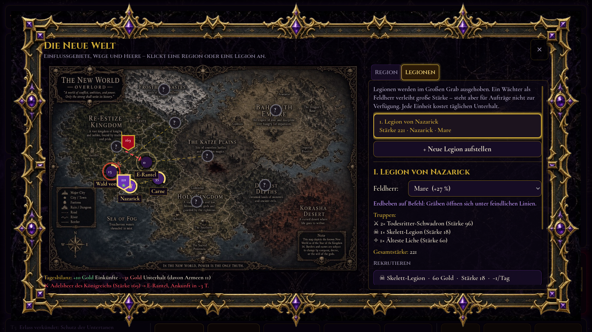
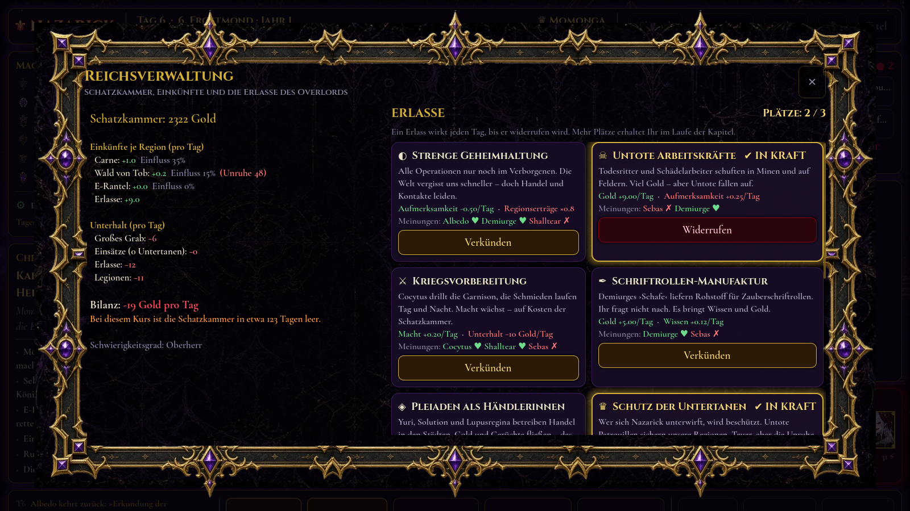
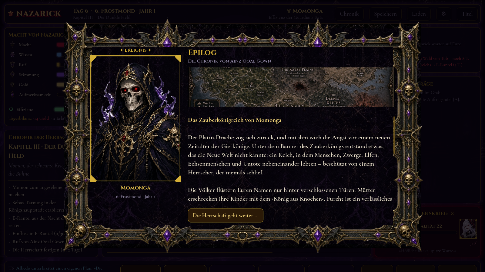
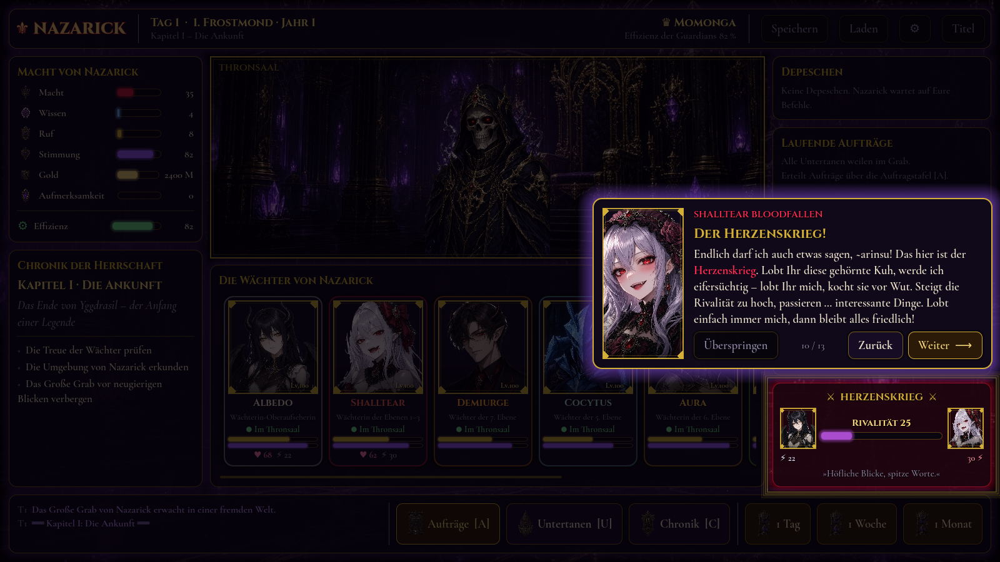
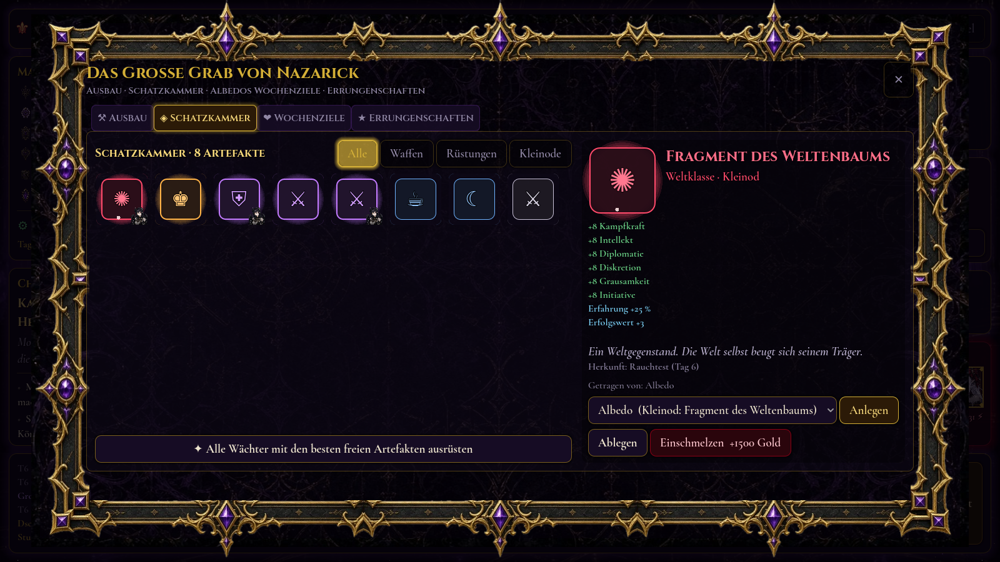
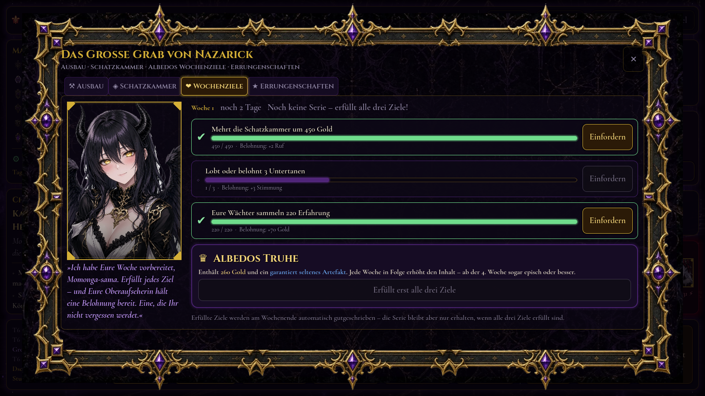
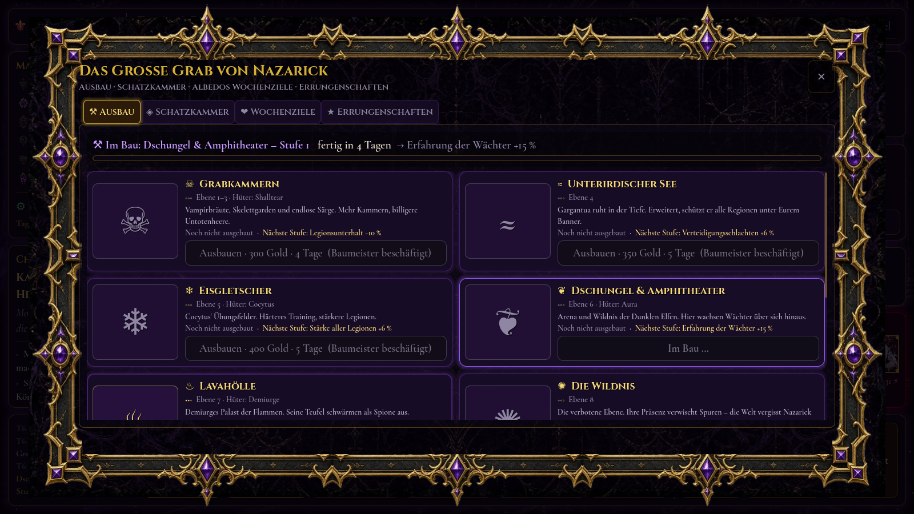
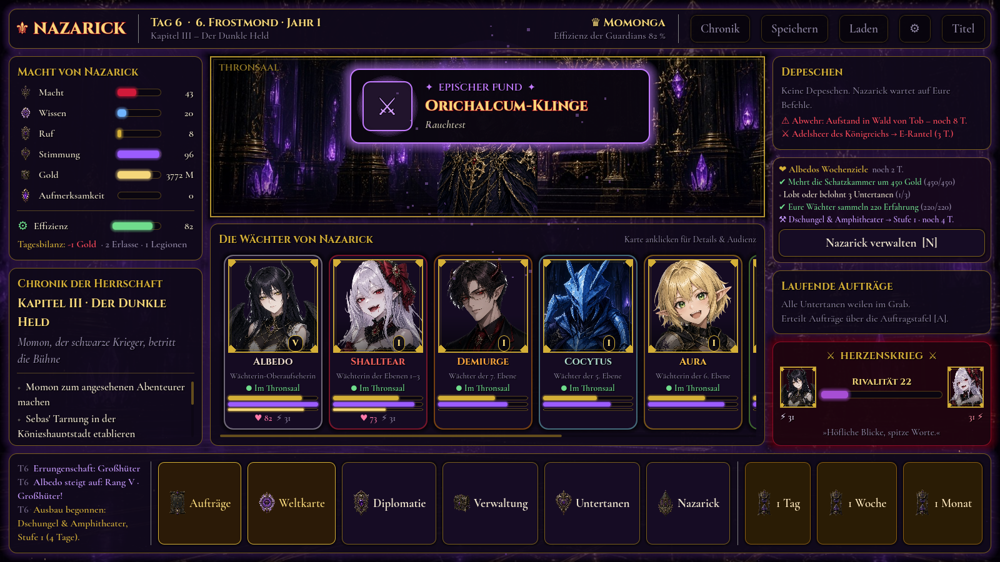

# Overlord – Herrscher von Nazarick

Ein 2D-Strategie-, Verwaltungs- und Story-Spiel in **Godot 4** (GDScript), inspiriert von *Overlord*, optisch angelehnt an *Lord of Nazarick*, spielerisch an Aufbau- und Strategiespiele wie *Anno* oder *Civilization*.
Du bist **Momonga / Ainz Ooal Gown**: Herrscher und Verwalter des Großen Grabes. Du erteilst Befehle, verwaltest Finanzen und Erlasse, dehnst Nazaricks Einfluss über die Neue Welt aus, führst Legionen in die Schlacht – und deine Wächter führen alles auf **ihre eigene Weise** aus.


| Weltkarte & Legionen | Reichsverwaltung & Erlasse |
|---|---|
|  |  |
| **Bericht im Charakterstil** | **Schlacht** |
|  |  |
| **Auftragstafel mit Teams** | **Einführung** |
|  |  |
| **Schatzkammer & Artefakte** | **Albedos Wochenziele** |
|  |  |
| **Ausbau der Ebenen** | **Legendärer Fund** |
|  |  |

Die Artworks (Portraits, Hintergründe, Rahmen, Icons) liegen in `assets/`. Fehlt ein Bild, zeichnet das Spiel automatisch einen stilisierten Platzhalter.

---

## Installieren (Windows)

1. `OverlordNazarick-Setup-1.5.0.exe` ausführen (liegt nach dem Build unter `build/`).
2. Windows SmartScreen meldet evtl. „Unbekannter Herausgeber“ (die Datei ist nicht signiert) → **Weitere Informationen → Trotzdem ausführen**.
3. Installation durchklicken – danach gibt es Verknüpfungen auf dem Desktop und im Startmenü. Deinstallieren über „Apps & Features“.

Selbst bauen (Linux/macOS/WSL mit Godot 4.3, Windows-Exportvorlage und NSIS):

```bash
GODOT=/pfad/zu/godot ./tools/build_windows.sh
# → build/windows/OverlordNazarick.exe        (portable Einzeldatei, kein Installer nötig)
# → build/OverlordNazarick-Setup-1.5.0.exe    (Installer mit Startmenü/Desktop-Verknüpfung)
```

---

## Starten aus dem Quellcode

1. **Godot 4.3** oder neuer installieren (Standard-Version, kein .NET nötig): <https://godotengine.org/download>
2. Godot öffnen → **Importieren** → `project.godot` in diesem Ordner wählen → **Importieren & Bearbeiten**.
3. **F5** (oder ▶ oben rechts) – das Spiel startet mit dem Titelbildschirm.

Ohne Editor, direkt aus der Kommandozeile:

```bash
godot --path /pfad/zu/Overlord
```

Renderer: *Compatibility* (OpenGL 3.3) – läuft also auch auf älteren Grafikkarten und Laptops. Fenstergröße 1600×900, frei skalierbar.

---

## Third-Person: Nazarick begehen

Seit Version 1.4 betrittst du Nazarick und die Neue Welt **selbst** – als Ainz Ooal Gown in der dritten Person.


| Steuerung | |
|---|---|
| Gehen / Rennen / Schweben | `WASD` / `Shift` / `Leertaste` |
| Kamera / Zoom | Maus (Klick fängt den Zeiger) / Mausrad |
| Sprechen, benutzen | `E` |
| Gate (Reisen), Zeit, Aufträge, Karte | `G`, `T`, `J`, `M` |
| Diplomatie, Verwaltung, Nazarick, Wächter | `P`, `V`, `N`, `U` |
| Klassische Thronsaal-Übersicht ↔ 3D | `Tab` |

- **20 begehbare Orte**: Thronsaal, Grabkammern, Eisgletscher, Dschungel & Amphitheater, Lavahölle, Königliche Gemächer, Bibliothek von Ashurbanipal, Schatzkammer – sowie Carne, E-Rantel, die Königshauptstadt, Arwintar, das Heilige Königreich, die Theokratie, der Wald von Tob, der Elfenwald, die Sümpfe, die Katze-Ebene, das Azerlisia-Gebirge und die Drachenlande. Reisen per **Gate**; Regionen der Welt müssen erst erkundet sein.
- **Die Wächter sind dort, wo sie wirklich sind**: im Thronsaal, auf ihrer Ebene, am Einsatzort ihres Auftrags oder als Feldherr bei ihrer Legion – Stimmung, Eifersucht und Kampf sieht man ihren Portraits an. Ansprechen öffnet die Audienz.
- **Thron** (Zeit), **Kriegsrat** (Aufträge, Karte, Diplomatie), **Albedos Pult** (Verwaltung, Ausbau, Schatzkammer, Wochenziele) und **Lagetafeln** in jeder Region verbinden die Welt mit allen Management-Systemen.
- Die **Zeit läuft in Echtzeit** (ein Tag je 45 Sekunden, am Thron anhaltbar); Berichte, Ereignisse und Schlachten erscheinen als Depeschen.
- Story-Figuren begegnen dir je nach Kapitel: Gazef, Nigun, Clementine, Hamsuke, Jircniv, Neia, die Platinrüstung …

Alle Umgebungen werden prozedural aus Primitiven aufgebaut (keine externen 3D-Modelle nötig); Himmel und Figuren nutzen die Artworks aus `assets/`.

## Kampfsystem (Third-Person, im Stil von The Witcher 3)

| Aktion | Taste |
|---|---|
| Leichte Attacke (Kombo) / Schwere Attacke | linke / rechte Maustaste |
| Ausweichrolle (mit i-Frames) | `Leertaste` |
| Blocken – früh gedrückt = **Parieren** | `F` halten |
| Ziel fixieren (Lock-on) | `Q` |
| Zauber bzw. Techniken | `1` `2` `3` `4` `R` |
| Kampfstil wechseln: Ainz ↔ Momon | `X` |

- **Zustandsautomat** für Spieler und Gegner (`scripts/combat/fighter.gd`): Bereit · Bewegung · Angriff (*Wind-up → aktiv → Recovery*) · Ausweichen · Block · Zauber · Taumeln · Gelähmt · Tot.
- **Hitboxes/Hurtboxes** (`hitbox.gd`, `hurtbox.gd`): echte Area3D-Trefferzonen auf getrennten Physik-Ebenen; jeder Angriff trifft ein Ziel höchstens einmal, Bogen-/Reichweitenprüfung inklusive.
- **Ausdauer** (schwere Attacken, Rolle, Blocken, Momons Techniken) und **Mana** (Ainz' Zauber) regenerieren sich; **Haltung (Poise)** bricht bei wuchtigen Treffern → Taumeln.
- **Schaden**: Rüstung mindert physischen Schaden, Widerstände je Schadensart (physisch, Feuer, negativ, heilig); wer nach einem verfehlten Angriff in der Recovery steht, nimmt mehr Schaden.
- **Statuseffekte**: Brennen (Schaden über Zeit), Unterkühlt (verlangsamt), Gelähmt, Schutzbarriere.
- **Ainz** – magiefokussiert: Stabhiebe plus *Feuerkugel* (Projektil, entzündet), *Druckwelle* (stößt zurück, bricht Deckung – wie Aard), *Größere Magische Schutzbarriere* (absorbiert einen Treffer – wie Quen), *Lähmung* (wie Axii) und der starke **Herzgriff**.
- **Momon** – zwei Großschwerter: 3-Schlag-Kombo, Großschwert-Spaltung, *Sprungangriff* und *Schwerterwirbel* (Ausdauer); mehr Leben und Rüstung, kaum Mana.
- **Gegner mit lesbaren Mustern** (`enemy_3d.gd`, Werte in `data/combat.json`): Skelettkrieger, Todesritter, Ritter der Schrift, Wölfe, Engel der Herrschaft, Echsenkrieger, Quagoa, Elfenkrieger und ein Übungsgolem in der Arena der 6. Ebene. Beim Ausholen leuchten sie **orange (blockbar)** oder **rot (nur ausweichen!)**, zielen bis kurz vor dem Schlag nach und bleiben danach in ihrer Richtung – Ausweichen zur Seite lohnt sich.
- Begegnungen je Ort in `data/locations.json` (`encounters`). Besiegte Gegner bringen Gold, Eliten zusätzlich Beute. Fällt Ainz, zieht er sich nach Nazarick zurück (Stimmung −4).
- Werte anpassen: `data/combat.json` (Stile, Angriffe mit `windup/active/recovery/damage/range/arc/stagger/lunge/unblockable`, Zauber, Gegner).

---

## 3D-Modelle (.glb) einbinden

Das Spiel nutzt **echte 3D-Modelle**, sobald sie vorhanden sind – sonst automatisch die bisherigen Ersatzfiguren (Portrait-Aufsteller bzw. prozedurale Modelle aus Grundformen). Die 2D-Portraits bleiben für Dialoge, Berichte und Menüs erhalten.

**Ablage** (Dateiname = ID, `.glb` empfohlen, auch `.gltf`/`.tscn`):

| Ordner | Inhalt |
|---|---|
| `assets/models/characters/<id>.glb` | Figuren: Ainz, Momon, Wächter, NPCs, Gegner |
| `assets/models/props/<id>.glb` | Requisiten/Gebäude, ersetzen die Grundformen überall im Spiel |
| `assets/models/locations/<ort>.glb` | ein ganzer Ort – ersetzt das prozedurale Rezept komplett |

Zusätzlich lädt das Spiel Modelle **zur Laufzeit ohne Neu-Export** aus `<Spielordner>/models/<kind>/` und `user://models/<kind>/` (z. B. `%APPDATA%\Godot\app_userdata\Overlord – Herrscher von Nazarick\models\characters\albedo.glb`).

**Anforderungen**
- Maßstab 1 Einheit = 1 Meter, Figuren ca. 1,8–2,3 m, Ursprung zwischen den Füßen, Blick nach **+Z** (sonst `rot_y` in `data/models.json`).
- Figuren mit Skelett und Animationen im selben `.glb`. Erkannt werden (Groß-/Kleinschreibung egal, Teilwort genügt – erweiterbar in `data/models.json → animation_aliases`):
  `idle`, `walk`, `run`, `attack_light` (*attack, slash, attack1 …*), `attack_heavy` (*heavy, slam, attack2 …*), `dodge` (*roll*), `block`, `hit`, `stagger`, `death`, `cast`.
  Angriffs-Animationen werden automatisch auf die Dauer des jeweiligen Angriffs gestreckt.
- Pro Modell optional in `data/models.json`: `{"characters": {"albedo": {"scale": 1.0, "rot_y": 180, "y": 0, "anims": {"attack_light": "Albedo_Slash"}}}}`.
- Requisiten erhalten automatisch eine Kollision aus ihren Meshes.
- Orts-Modelle können Ankerpunkte als benannte Knoten (Empty/Marker) enthalten: `Spawn`, `Gate`, `Throne`, `Table`, `Desk`, `Board`, `Keeper`, `Slot1` … `SlotN`.
- Quellen: selbst modelliert (Blender), lizenzfreie Pakete oder KI-Generatoren mit passender Lizenz; Animationen z. B. über Mixamo. Keine Modelle aus offiziellen Spielen/Anime ohne Rechte.

**Noch fehlende Modelle** (alle derzeit Ersatzfiguren):

- Figuren: `ainz`, `ainz_momon`, `albedo`, `shalltear`, `demiurge`, `cocytus`, `aura`, `mare`, `sebas`, `narberal`, `pandora`, `solution`, `yuri`, `lupusregina`, `entoma`, `cz`, `victim`, `neuronist`, `gazef`, `jircniv`, `neia`, `hamsuke`, `nigun`, `clementine`, `platinum_dragon`, `death_knight`, `skeleton`, `death_knight`, `soldier`, `wolf`, `angel`, `golem`
- Requisiten: `house`, `tower`, `tree`, `tree_conifer`, `rock`, `brazier`, `pillar`, `crystal`, `banner`, `throne`, `war_table`, `desk`, `gate_portal`, `coffin`, `bookshelf`, `tent`, `stilt_hut`, `gold_pile`, `chest`, `palace`, `cathedral`, `city_wall_segment`, `ice_spike`, `statue`
- Ganze Orte (optional): `throne`, `tombs`, `glacier`, `jungle`, `lava`, `royal`, `library`, `treasury`, `carne`, `e_rantel`, `re_capital`, `baharuth`, `roble`, `theokratie`, `tob_wald`, `elfen`, `sumpf`, `katze`, `azerlisia`, `drachen`

Der Test `tools/combat_test.tscn` erzeugt zur Laufzeit ein Test-`.glb` mit Animationen, lädt es über `ModelLib`, prüft die Animationszuordnung und das Platzieren eines Requisits mit Kollision.

---

## Spielanleitung

| Aktion | Wo | Taste |
|---|---|---|
| Aufträge erteilen | Fußleiste → **Aufträge** | `A` |
| Weltkarte, Legionen | Fußleiste → **Weltkarte** | `K` |
| Diplomatie | Fußleiste → **Diplomatie** | `P` |
| Finanzen & Erlasse | Fußleiste → **Verwaltung** | `V` |
| Untertanen ansehen, Audienz gewähren, ausrüsten | Wächterkarte anklicken / **Untertanen** | `U` |
| Nazarick: Ausbau, Schatzkammer, Wochenziele, Errungenschaften | Fußleiste → **Nazarick** | `N` |
| Chronik (Event-Log) | Kopfleiste → **Chronik** | `C` |
| Nächste Depesche öffnen | Depeschen-Panel | `D` |
| Zeit vergehen lassen: 1 Tag / 1 Woche / 1 Monat | Fußleiste rechts | `1` / `2` / `3` |
| Speichern | Kopfleiste | `F5` |
| Vollbild | – | `F11` |
| Optionen (Audio, Grafik, Spiel, Steuerung) | Kopfleiste ⚙ / Titelbildschirm | – |

**Der Kreislauf**

1. **Auftrag wählen** – Hauptaufträge (★) treiben die Story voran, Nebenaufträge (◆) bringen Ressourcen, Vorschläge (✧) stammen von deinen Untertanen selbst.
2. **Vollstrecker wählen** – jede Kachel zeigt die Erfolgsaussicht. Manche Aufträge kann nur ein bestimmter Charakter erledigen.
3. **Befehlsart wählen**: *Freie Hand*, *Im Verborgenen*, *Gnadenlos*, *Diplomatisch*, *Mit höchster Eile*.
   Die Tafel warnt dich, wenn ein Charakter dazu neigt, einen Befehl **eigenmächtig auszulegen** (Shalltear und „diskret“ … nun ja), und zeigt seinen **eigenen Stil** bei *Freier Hand* (Demiurge: „Der Große Plan“).
4. **Zeit vergehen lassen.** Sie stoppt automatisch, sobald eine **Depesche** eintrifft: Bericht, Ereignis, Eigeninitiative oder Vorschlag.
5. **Reagieren** – loben, belohnen, tadeln oder schweigen. Jede Reaktion hat Folgen – besonders bei Albedo und Shalltear.

**Ressourcen**: Macht · Wissen · Ruf · Stimmung · Gold · **Aufmerksamkeit** (wie sehr die Welt auf Nazarick aufmerksam wird – hohe Werte locken gefährliche Mächte an) · **Effizienz der Guardians** (aus Stimmung, Gunst und Erschöpfung).

**Herzenskrieg**: Lobst du Albedo, wird Shalltear eifersüchtig – und umgekehrt. Steigt die Rivalität, kommt es zu Streit im Thronsaal, nächtlichen Besuchen, eigenmächtigen Intrigen und im Extremfall zu einem Duell im Amphitheater. Vernachlässigte oder eifersüchtige Untertanen ergreifen häufiger eigenmächtig die Initiative.

**Die Strategie-Ebene**

- **Weltkarte [K]** – 11 Regionen mit Einfluss, Unruhe und täglichen Einkünften. Regionen müssen erst erkundet werden; Einfluss wächst durch Aufträge (mit abnehmendem Ertrag), Grausamkeit erzeugt Unruhe und Aufstände.
- **Reichsverwaltung [V]** – Finanzübersicht (Einkünfte je Region, Unterhalt für Grab, Einsätze, Erlasse und Legionen) und **Erlasse**: zehn Regierungsentscheidungen mit laufenden Kosten und Wirkungen, begrenzte Plätze, und jeder Wächter hat eine Meinung dazu.
- **Diplomatie [P]** – 8 Fraktionen (Königreich Re-Estize, Baharuth-Kaiserreich, Slane-Theokratie, Argland-Rat, Zwerge, Heiliges Königreich Roble, Elfenkönigreich) mit Beziehung, Furcht und Verträgen: Geschenke, Handelsabkommen, Nichtangriffspakt, Machtdemonstration, Tribut, Vasallentum, Frieden, Krieg. Gesandtschaften führt ein Wächter aus – Albedo verhandelt brillant, Shalltear … eher nicht. Fraktionen reagieren auf Ruf und Aufmerksamkeit, schicken eigene Gesandte und erklären bei Hass den Krieg.
- **Legionen & Schlachten** – Skelette, Todesritter, Liche, Seelenfresser, Todesreiter … im Grab ausheben, einen Wächter zum Feldherrn ernennen (er fehlt dann für Aufträge), über das Wegenetz marschieren lassen (die Heere ziehen sichtbar über die Karte, mit eigener Zeitsteuerung), Regionen erobern oder feindliche Heere abfangen. Schlachten laufen in einer eigenen, animierten Schlachtansicht mit Taktikwahl und Schlachtmusik.
- **Bedrohungen mit Frist** – Inquisition, Spione, Aufstände, Abenteurer-Expeditionen, der Platin-Drache: Wer nicht rechtzeitig reagiert, verliert Gebiete, Gold und Ansehen.
- **Lageberichte** – Mitten im Auftrag melden sich die Untertanen mit Komplikationen: Zeugen, starke Gegner, Doppelagenten … du entscheidest über Risiko, Dauer und Methode – oder lässt dem Wächter freie Hand.
- **Teams** – zwei Untertanen gemeinsam entsenden; Synergien (Aura + Mare, Albedo + Demiurge) und Konflikte (Albedo + Shalltear, Demiurge + Sebas).
- **Vier Schwierigkeitsgrade** – von *Gnädiger Herrscher* bis *Albtraum von Nazarick* (Startgold, Einkünfte, Unterhalt, Bedrohungen, Feindstärke).
- **Kapitelziele** verlangen neben Story-Entscheidungen auch Einfluss, Ressourcen und Zeit – das Reich muss wirklich wachsen.

**Das Große Grab wächst mit – „nur noch eine Woche …“**

- **Wächter-Ränge I–X** – jeder Auftrag, jede Schlacht und jede Audienz bringt Erfahrung. Ein Rangaufstieg (vom *Getreuen* bis zur *Legende von Nazarick*) erhöht alle Werte und stärkt die Legion, die der Wächter führt. Fanfare inklusive.
- **Artefakte & Schatzkammer** – 35 Artefakte in fünf Seltenheiten (*Gewöhnlich, Selten, Episch, Legendär, Weltklasse*): Triumphe, Schlachten, gebannte Bedrohungen, Errungenschaften und Albedos Truhe bringen Beute. Jeder Wächter hat Waffe, Rüstung und Kleinod; Lieblingsstücke (Spuhletit-Lanze für Shalltear, Frosthellebarde für Cocytus …) wirken stärker. Überzählige Funde lassen sich einschmelzen.
- **Ausbau der Ebenen** – 10 Bauwerke × 3 Stufen (Grabkammern, Gletscher, Amphitheater, Lavahölle, Königliche Gemächer, Bibliothek von Ashurbanipal, Schatzkammer, Golemschmiede …): billigere Legionen, stärkere Heere, mehr Erfahrung, Gold, Wissen, Audienzen, Beute. Immer nur ein Bauprojekt zugleich – jede Entscheidung zählt.
- **Albedos Wochenziele** – jede Woche drei neue Ziele mit Belohnung; wer alle erfüllt, öffnet **Albedos Truhe** (Gold + garantiert seltenes Artefakt). Aufeinanderfolgende Wochen bauen eine **Serie** auf, die die Truhe immer wertvoller macht.
- **37 Errungenschaften** in Bronze, Silber, Gold und Platin – mit Belohnungen bis hin zu einem Weltgegenstand.

**Story**: 11 Kapitel – *Die Ankunft · Das Dorf Carne · Der Dunkle Held · Blutiger Wahnsinn (der Shalltear-Zwischenfall) · Frost über dem Sumpf · Gehenna · Das Zauberkönigreich · Die Hallen von Feo Jera · Das Heilige Königreich · Der Wald der Elfen · Der Platin-Drachenlord* – mit einem **Epilog**, der sich aus deinen Entscheidungen zusammensetzt (Weltordnung, Ruf, Vasallen, Albedo & Shalltear, das Schicksal jedes Wächters). Danach geht die Herrschaft endlos weiter. Dazu 42 Aufträge (10 Haupt-, 15 Neben-, 17 Vorschlagsaufträge), 33 Ereignisse und 23 Eigeninitiativen, mit Verzweigungen (Carne retten oder ignorieren, Name „Ainz Ooal Gown“ annehmen oder Momonga bleiben, Shalltear selbst stellen oder Albedo schicken …).

Spielstände liegen in `user://saves/` (Windows: `%APPDATA%\Godot\app_userdata\Overlord – Herrscher von Nazarick\saves`).

---

## Projektstruktur

```
project.godot              Projekt (Autoloads, Theme, Compatibility-Renderer)
scenes/
  title_screen.tscn        Titelbildschirm
  throne_room.tscn         Thronsaal – zentrale Hub-Szene
scripts/
  autoload/
    content.gd             lädt data/*.json
    game.gd                Spielzustand & Spiellogik (Aufträge, Zeit, Emotionen, Depeschen)
    world.gd, military.gd, diplomacy.gd   Regionen/Wirtschaft, Legionen/Schlachten, Fraktionen
    progress.gd            Ränge, Artefakte, Ausbau, Wochenziele, Errungenschaften
  world3d/
    world_3d.gd            Third-Person-Welt: Orte laden, HUD, Interaktion, Echtzeit, Depeschen, Kampf-HUD
    player_3d.gd           Ainz/Momon: Steuerung, Kamera, Kampf, Lock-on, Zauber
    model_lib.gd           findet/lädt .glb-Modelle (auch zur Laufzeit)
    character_rig.gd       Modell oder Ersatzfigur + Animationssteuerung
    proc_model.gd          prozedurale Ersatzfiguren mit Gelenken
    actor_3d.gd            Figuren als Portrait-Aufsteller, Interaktionsobjekte
    location_builder.gd    Rezepte der 20 Orte (Thronsaal, Gletscher, Stadt, Wald …)
    b3.gd                  3D-Baukasten (Materialien, Primitive mit Kollision, Licht, Partikel)
  combat/
    fighter.gd             Kämpfer-Basis: Zustandsautomat, Werte, Treffer, Status
    hitbox.gd, hurtbox.gd  Trefferzonen
    enemy_3d.gd            Gegner-KI mit Wind-up/Angriff/Recovery
    projectile.gd          Zauberprojektile
    save_system.gd         JSON-Speichern/Laden (3 Slots)
  scenes/                  Skripte der Szenen
  ui/
    palette.gd             zentrale Farbpalette
    nazarick_theme.gd      erzeugt das Theme (→ assets/ui/nazarick_theme.tres)
    ui_fx.gd               Tween-Animationen (Einblenden, Pop-in, Hover, Pulsieren, Schreibmaschine)
    portrait.gd            Portrait mit Rahmen; Bild-Asset oder prozeduraler Platzhalter
    guardian_card.gd       Statuskarte eines Wächters
    rivalry_meter.gd       „Herzenskrieg“-Anzeige Albedo ⚔ Shalltear
    throne_visual.gd       gezeichneter Thron mit dem Overlord
    background.gd          Shader-Hintergrund + Partikel
    overlay.gd             Basisklasse modaler Fenster
    dispatch_dialog.gd     Berichte / Ereignisse / Vorschläge
    mission_board.gd       Auftragstafel
    character_view.gd      Charakter-Details & Audienzen
    chronicle_view.gd, save_load_dialog.gd, portrait_button.gd, stat_bar.gd
data/
  characters.json          Charaktere: Werte, Stimme, Gefühle, Reaktionen, Vorschläge
  missions.json            Aufträge (Haupt, Neben, Vorschläge)
  events.json              Story-, Zufalls- und Rivalitätsereignisse + Eigeninitiativen
  story.json               Kapitel und Befehlsarten
  regions.json, factions.json, systems.json   Strategie-Ebene
  progression.json         Ränge, Artefakte, Ebenen, Wochenziele, Errungenschaften
  locations.json           begehbare 3D-Orte, Story-Figuren, Begegnungen
  combat.json              Kampfstile, Angriffe, Zauber, Gegner
  models.json              Einstellungen & Animationsnamen für 3D-Modelle
assets/
  ui/                      Theme, Schriften (Cinzel, Cormorant Garamond, DejaVu – alle frei lizenziert)
  shaders/                 Hintergrund-Shader
  characters/              ← hier Portraits ablegen
  backgrounds/             ← hier Hintergründe ablegen
tools/                     Theme-Builder, Simulations- und UI-Tests
```

---

## Art-Assets

Enthalten: 10 Charakterportraits (+ verliebte Varianten von Albedo und Shalltear, die bei hoher Gunst oder Lob erscheinen), 7 NPC-Portraits (Pleiaden, Victim, Neuronist), 9 Hintergründe (Thronsaal, Nazarick, Carne, Re-Estize, Baharuth, Heiliges Königreich, Wald, Schlachtfeld, Weltkarte), Ornamentrahmen und Icons. Die ursprünglich eingebrannten Schachbrett-„Transparenzen“ wurden freigestellt (WebP mit Alphakanal).

Eigene Bilder ersetzen oder ergänzen – kein Code nötig:

| Datei | Wirkung |
|---|---|
| `assets/characters/<id>.webp` (.png/.jpg) | Portrait (`albedo`, `shalltear`, `demiurge`, …, `ainz`). Hochformat; wird oben ausgerichtet beschnitten. `<id>_love.webp` = verliebte Variante. |
| `assets/backgrounds/throne_room.jpg` | Thronsaal (Hintergrund + Thronansicht) |
| `assets/backgrounds/title.jpg` | Titelbildschirm (sonst `nazarick_exterior`) |
| `assets/backgrounds/<ort>.jpg` | Ortsbilder in Berichten – Zuordnung per Stichwort in `Content.LOCATION_IMAGES` oder per `"image"` im Ereignis |
| `assets/ui/frames/frame_gold.webp`, `frame_skull.webp` | Ornamentrahmen der Fenster (9-Slice) |
| `assets/ui/icons/icon_*.webp` | Icons für Ressourcen und Aktionsknöpfe |
| `assets/ui/icons/item_<id>.webp`, `frame_<seltenheit>.webp` | Artefakt-Icons (IDs in `data/progression.json`) und Seltenheitsrahmen |
| `assets/backgrounds/floor_*.jpg`, `treasury.jpg`, `forge.jpg` | Bilder der Ebenen im Ausbau-Bildschirm |

Eine vollständige Liste gewünschter Grafiken steht in `docs/ASSET_WUNSCHLISTE.txt`.

Bitte nur Bilder verwenden, an denen du die Rechte hast.

---

## Inhalte erweitern

Alle Inhalte sind JSON – neue Aufträge, Ereignisse oder Charaktere brauchen **keinen Code**.

**Neuer Auftrag** (`data/missions.json`):

```json
{
  "id": "s_beispiel", "title": "Der verfluchte Turm",
  "category": "Erkundung", "location": "Azerlisia-Gebirge",
  "description": "…", "days": 4, "difficulty": 55,
  "weights": {"intellekt": 2, "kampf": 1},
  "recommended": ["aura"],
  "rewards": {"info": 8, "gold": 50},
  "requires": {"chapter_min": 3},
  "on_success": {"set_flags": ["turm_erkundet"]},
  "outcomes": {"triumph": "…", "success": "…", "partial": "…", "failure": "…"},
  "char_outcomes": {"shalltear": {"success": "Text in Shalltears Stimme …"}}
}
```

Optionale Felder: `main`, `repeatable`, `required_char`, `forced_tier`, `followup_event`, `replace_report_with_event`, `failure`, `proposal` + `proposal_text` + `proposal_requires` (Vorschläge erscheinen nur, wenn ein Charakter sie unterbreitet – dazu die ID in `proposals` des Charakters eintragen).

**Neues Ereignis** (`data/events.json`): `type` ist `story` (einmalig, sobald `trigger` erfüllt), `random`/`rivalry` (gewichtet, mit `cooldown`/`once`) oder `chain` (nur über `queue_events`/`followup_event`). Jede Wahl (`choices`) hat `label`, `effects`, `reaction`, optional `variant` (`primary`, `danger`, `success`, `warning`) und `requires`.

**Bedingungen** (`requires`, `trigger`): `chapter`, `chapter_min/max`, `day_in_chapter_min`, `flags_all/none/any`, `rivalry_min/max`, `res_min/max`, `jealousy_min`, `favor_min/max`, `idle`, `unlocked`, `missions_done`.

**Effekte** (`effects`, `on_success`, `on_trigger`): `res`, `chars` (favor/mood/jealousy/fatigue), `rivalry`, `set_flags`, `clear_flags`, `unlock_missions`, `unlock_chars`, `status`, `lord_name`, `log`, `queue_events`.

**Platzhalter in Texten**: `{lord}` → „Momonga-sama“ bzw. „Ainz-sama“, `{lord_full}` → voller Name. Texte unterstützen BBCode (`[i]`, `[b]`, `[color=#ff2a4f]…[/color]`).

**Neuer Charakter**: Eintrag in `data/characters.json` nach dem Muster der vorhandenen (Werte, `voice`, `reactions`, `audience`, optional `emotion` + `rival` für eifersüchtige Charaktere, `deviations` für eigenmächtige Auslegungen, `style` für Freie Hand). Mit `"unlocked": false` startet er gesperrt und wird per Effekt `unlock_chars` freigeschaltet.

**Theme ändern**: Farben in `scripts/ui/palette.gd`, Stile in `scripts/ui/nazarick_theme.gd`, danach neu bauen:

```bash
godot --headless --path . --script res://tools/build_theme.gd
```

---

## Tests

```bash
# Spielt 6 Partien mit zufälligen Entscheidungen bis zum Ende, prüft Speichern/Laden
godot --headless --path . res://tools/sim_test.tscn
# Öffnet alle Fenster der UI und speichert Screenshots nach tools/screenshots/
godot --path . res://tools/ui_smoke_test.tscn
godot --path . res://tools/world3d_test.tscn     # besucht alle 3D-Orte (LOC=<id> für einen, LOC=combat für den Kampf)
godot --headless --path . res://tools/combat_test.tscn   # Kampfsystem + .glb-Laden
```

---

*Nicht-kommerzielles Fan-Projekt. „Overlord“ © Kugane Maruyama / KADOKAWA. Schriften: Cinzel & Cormorant Garamond (SIL OFL), DejaVu Sans (freie Lizenz).*
